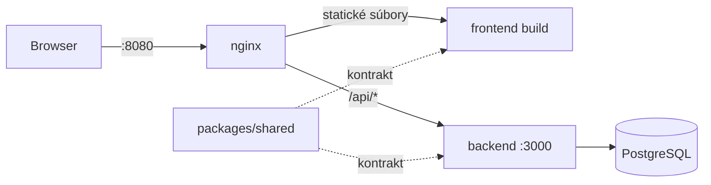

# Architektúra

## Monorepo

pnpm workspaces s balíkmi `frontend` (React SPA), `backend` (Express API), `packages/shared` (zdieľaný kontrakt) a `e2e` (Playwright).

FE a BE bežia na rovnakom origine: v Dockeri cez nginx proxy, vo vývoji cez Vite proxy. CORS sa preto nepoužíva.

Podrobnosti o Docker službách a auth flow pribudnú v krokoch, v ktorých vzniknú.
