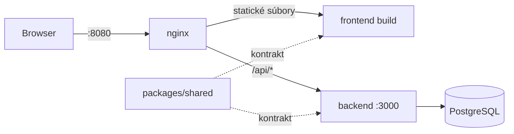
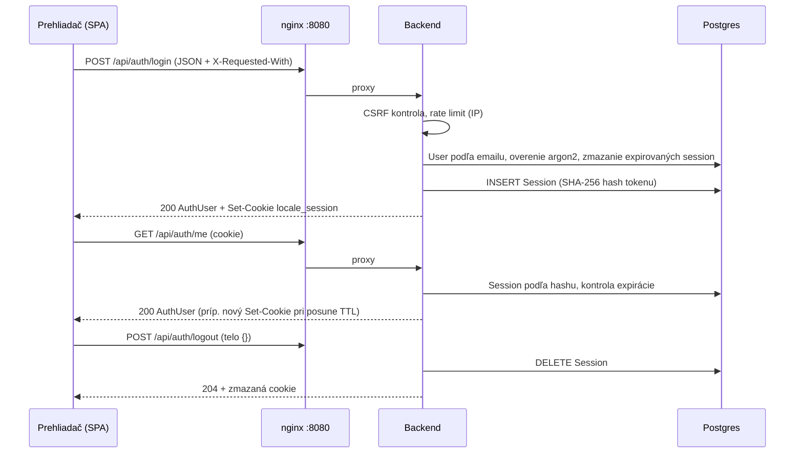

# Architektúra

## Monorepo

pnpm workspaces:

| Balík                                | Obsah                                                                         |
| ------------------------------------ | ----------------------------------------------------------------------------- |
| `frontend`                           | React SPA (Vite+, Mantine, Tailwind, TanStack Router a Query, react-i18next)  |
| `backend`                            | Express 5 API, Prisma 7, PostgreSQL                                           |
| `packages/shared` (`@locale/shared`) | zdieľaný kontrakt: zod schémy, typy, chybové a validačné kódy, pravidlá hesla |
| `e2e`                                | Playwright testy voči produkčnému stacku                                      |

FE a BE nikdy nedefinujú vlastné schémy požiadaviek a odpovedí, iba ich importujú z `@locale/shared`.

## Komunikácia

FE a BE bežia na rovnakom origine: v Dockeri cez nginx proxy, vo vývoji cez Vite proxy. CORS sa preto nepoužíva. Axios na FE má `baseURL: '/api'`.

## Docker služby

| Služba     | Image                                                              | Port na hoste      | Healthcheck                 |
| ---------- | ------------------------------------------------------------------ | ------------------ | --------------------------- |
| `db`       | `postgres:17-alpine`                                               | `5433` (`DB_PORT`) | `pg_isready`                |
| `backend`  | `docker/backend.Dockerfile` (Node 24, multi-stage)                 | `3001` (iba debug) | `GET /api/health` vráti 200 |
| `frontend` | `docker/frontend.Dockerfile` (build cez Vite+, runtime nginx 1.30) | `8080`             | nginx vráti `index.html`    |

- Backend pri štarte spustí `prisma migrate deploy`, idempotentný seed a server (`docker/backend-entrypoint.sh`, server dostane SIGTERM a korektne sa ukončí). Beží ako používateľ `node`, súbory aplikácie patria `root` a nedajú sa meniť.
- Porty `5433` (DB) a `3001` (BE) sú naviazané iba na `127.0.0.1`.
- nginx proxuje `/api/*` na `backend:3000` s hlavičkami `X-Forwarded-*` (Express má `trust proxy 1`), statické assety cachuje natrvalo a pre ostatné cesty vracia `index.html` (SPA fallback). Pre `/api/` má `client_max_body_size 12m` (predvolené 1 MB by nepustilo import súboru); backend sám obmedzuje telo na 100 kB okrem rout importu (12 MB, [Import](./api/imports.md#limity)).
- Služby štartujú v poradí `db` → `backend` → `frontend`, každá čaká na zelený healthcheck predchádzajúcej.
- V kontajneri compose prepisuje `DATABASE_URL` na host `db`, lokálny `.env` ukazuje na `localhost:5433`.

## Auth flow

Session je uložená v Postgrese, prehliadač má iba httpOnly cookie `locale_session` s náhodným tokenom (rozhodnutie: [ADR 0004](./decisions/0004-db-session.md), endpointy: [api/auth.md](./api/auth.md)).

- **CSRF:** globálny middleware odmietne `POST`/`PUT`/`PATCH`/`DELETE` bez `Content-Type: application/json` a `X-Requested-With: XMLHttpRequest` (403 `CSRF_REJECTED`). Axios inštancia FE obe hlavičky posiela vždy.
- **Sliding TTL:** 7 dní od poslednej aktivity, najviac 30 dní od loginu. DB a cookie sa posúvajú najviac raz za 5 minút.
- **Role na BE:** router `/api/admin` má `requireAuth` + `requireRole(ADMIN)` pre všetky svoje endpointy (zatiaľ [správa používateľov](./api/admin-users.md)): neprihlásený dostane 401, `EDITOR` 403 `FORBIDDEN`.
- **FE guardy:** `beforeLoad` chránených rout načíta `GET /api/auth/me` cez TanStack Query. 401 → `/login`, prihlásený používateľ na `/login` → `/`, stránky iba pre `ADMIN` zobrazia ostatným 403.
