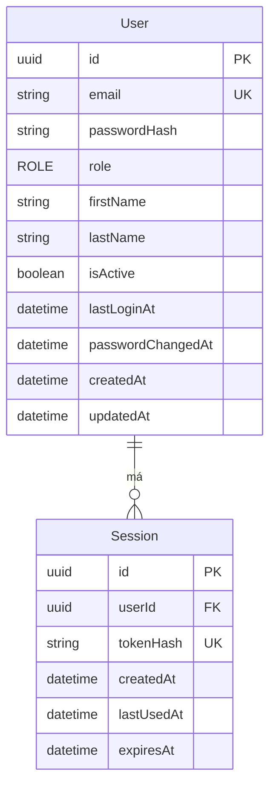

# Databáza

PostgreSQL 17, Prisma 7 s driver adapterom `@prisma/adapter-pg`. Schéma je v `backend/prisma/schema.prisma`, konfigurácia Prisma CLI v `backend/prisma.config.ts` (načíta root `.env`, už nastavené premenné majú prednosť). Prisma klient sa generuje do `backend/src/generated/prisma` (nie je v gite).

## Dátový model

### User

| Pole                     | Typ                | Poznámka                                        |
| ------------------------ | ------------------ | ----------------------------------------------- |
| `id`                     | UUID               | PK                                              |
| `email`                  | string, unique     | uložený normalizovaný (`trim()` + malé písmená) |
| `passwordHash`           | string             | argon2id, nikdy sa nevracia v API               |
| `role`                   | enum `ROLE`        | `ADMIN` alebo `EDITOR`, default `EDITOR`        |
| `firstName`, `lastName`  | string, nullable   | vyplnia sa neskôr na obrazovke Profil           |
| `isActive`               | boolean            | default `true`, neaktívny user sa neprihlási    |
| `lastLoginAt`            | datetime, nullable | nastaví sa pri úspešnom logine                  |
| `passwordChangedAt`      | datetime           | default čas vytvorenia                          |
| `createdAt`, `updatedAt` | datetime           |                                                 |

### Session

Server-side session pre prihlásenie (používa sa od míľnika B).

| Pole         | Typ            | Poznámka                                        |
| ------------ | -------------- | ----------------------------------------------- |
| `id`         | UUID           | PK                                              |
| `userId`     | UUID           | FK na `User`, pri zmazaní usera sa zmaže        |
| `tokenHash`  | string, unique | SHA-256 hash tokenu z cookie, nie samotný token |
| `createdAt`  | datetime       | čas prihlásenia                                 |
| `lastUsedAt` | datetime       | posledná aktivita                               |
| `expiresAt`  | datetime       | koniec platnosti                                |

Indexy: `userId`, `expiresAt`.

## Migrácie

Migrácie sú v `backend/prisma/migrations/` a commitujú sa do gitu.

| Príkaz (z rootu)  | Čo robí                                                                  |
| ----------------- | ------------------------------------------------------------------------ |
| `pnpm db:migrate` | `prisma migrate dev` (vytvorí a aplikuje migráciu v dev DB) a potom seed |
| `pnpm db:seed`    | iba seed                                                                 |
| `pnpm db:reset`   | zmaže lokálnu DB, aplikuje všetky migrácie a spustí seed                 |

Nová migrácia: zmeň `schema.prisma` a spusti `pnpm --filter backend exec prisma migrate dev --name <nazov>`.

V produkčnom stacku backend pri štarte spustí `prisma migrate deploy`, potom seed a až potom server (skript `start:prod`).

## Seed

Seed (`backend/prisma/seed.ts`) vytvorí admina `michal.bella@goodrequest.com` s rolou `ADMIN`.

- Heslo je z ENV `SEED_ADMIN_PASSWORD` a musí spĺňať pravidlá hesla z `packages/shared` (8 až 128 znakov). Ak chýba alebo je nevalidné, seed skončí s chybou a nič nevytvorí.
- Seed je idempotentný: ak admin s týmto emailom existuje, nemení nič (ani heslo, ani rolu). Zmena `SEED_ADMIN_PASSWORD` v `.env` existujúceho admina neovplyvní. Lokálne sa admin obnoví cez `pnpm db:reset`.

## Test databáza

Integračné testy bežia voči `locale_test` v tom istom Postgres kontajneri (`TEST_DATABASE_URL`). Ak názov DB nekončí na `_test`, testy sa nespustia. Podrobnosti v [Testovanie](./testing.md).
