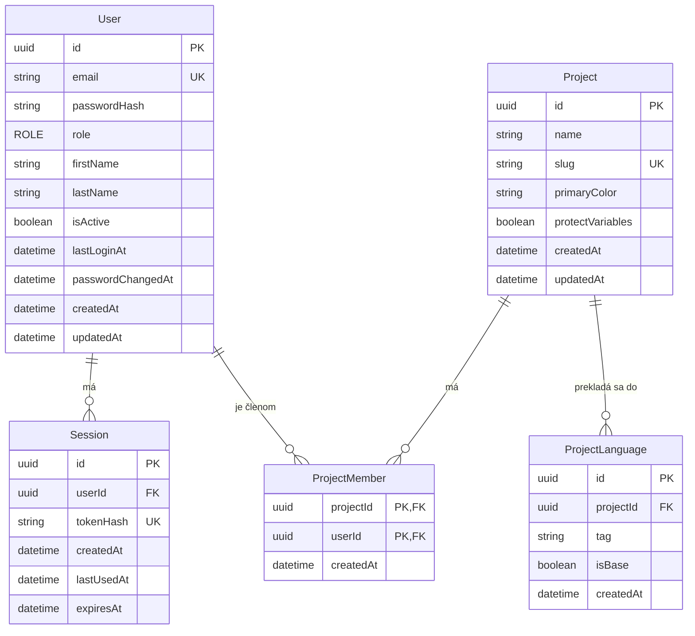

# Databáza

PostgreSQL 17, Prisma 7 s driver adapterom `@prisma/adapter-pg`. Schéma je v `backend/prisma/schema.prisma`, konfigurácia Prisma CLI v `backend/prisma.config.ts` (načíta root `.env`, už nastavené premenné majú prednosť). Prisma klient sa generuje do `backend/src/generated/prisma` (nie je v gite).

## Dátový model

### User

| Pole                     | Typ                | Poznámka                                                                                                           |
| ------------------------ | ------------------ | ------------------------------------------------------------------------------------------------------------------ |
| `id`                     | UUID               | PK                                                                                                                 |
| `email`                  | string, unique     | uložený normalizovaný (`trim()` + malé písmená)                                                                    |
| `passwordHash`           | string             | argon2id, nikdy sa nevracia v API                                                                                  |
| `role`                   | enum `ROLE`        | `ADMIN` alebo `EDITOR`, default `EDITOR`; `POST /api/admin/users` zakladá `ADMIN`, členov zakladá stránka Členovia |
| `firstName`, `lastName`  | string, nullable   | upravuje ich používateľ na obrazovke Môj profil (`PATCH /api/profile`)                                             |
| `isActive`               | boolean            | default `true`, neaktívny user sa neprihlási                                                                       |
| `lastLoginAt`            | datetime, nullable | nastaví sa pri úspešnom logine                                                                                     |
| `passwordChangedAt`      | datetime           | default čas vytvorenia                                                                                             |
| `createdAt`, `updatedAt` | datetime           |                                                                                                                    |

### Session

Server-side session pre prihlásenie. Jeden riadok = jedno prihlásenie v jednom prehliadači. Správanie API je v [API: auth](./api/auth.md).

| Pole         | Typ            | Poznámka                                                                                   |
| ------------ | -------------- | ------------------------------------------------------------------------------------------ |
| `id`         | UUID           | PK                                                                                         |
| `userId`     | UUID           | FK na `User`, pri zmazaní usera sa zmaže                                                   |
| `tokenHash`  | string, unique | SHA-256 (hex) tokenu z cookie `locale_session`; samotný token sa neukladá                  |
| `createdAt`  | datetime       | čas prihlásenia, od neho sa počíta absolútny limit `SESSION_MAX_AGE_DAYS` (default 30 dní) |
| `lastUsedAt` | datetime       | posledná zapísaná aktivita; zapisuje sa najviac raz za 5 minút                             |
| `expiresAt`  | datetime       | `min(lastUsedAt + SESSION_TTL_DAYS, createdAt + SESSION_MAX_AGE_DAYS)`, default TTL 7 dní  |

Životný cyklus:

- **Login** vytvorí riadok (`createdAt = lastUsedAt = teraz`) a zmaže všetky riadky s `expiresAt` v minulosti.
- **Požiadavka s prihlásením:** ak od `lastUsedAt` prešlo aspoň 5 minút, nastaví sa `lastUsedAt = teraz` a prepočíta `expiresAt`. Inak sa do DB nezapisuje.
- **Expirácia:** session s `expiresAt` v minulosti alebo staršia ako absolútny limit sa pri použití zmaže (401). Rovnako session neaktívneho usera.
- **Logout** zmaže riadok aktuálnej session, ostatné session usera ostanú.

Indexy: `userId`, `expiresAt`.

### ProjectLanguage

Jazyk projektu, do ktorého sa projekt prekladá. Ukladá sa iba tag, anglický a pôvodný názov a vlajku dopĺňa backend z katalógu `SUPPORTED_LANGUAGES` v `packages/shared` (upraviť sa nedajú). Správanie API je v [API: jazyky projektu](./api/project-languages.md).

| Pole        | Typ      | Poznámka                                                                  |
| ----------- | -------- | ------------------------------------------------------------------------- |
| `id`        | UUID     | PK                                                                        |
| `projectId` | UUID     | FK na `Project`, pri zmazaní projektu sa zmaže                            |
| `tag`       | string   | tag z katalógu (`sk`, `en`, `de-AT`, ...), v projekte unikátny            |
| `isBase`    | boolean  | default `false`, základný jazyk projektu; prvý jazyk projektu je základný |
| `createdAt` | datetime |                                                                           |

Indexy: unikátna dvojica (`projectId`, `tag`) a čiastočný unikátny index `ProjectLanguage_projectId_isBase_key` na `projectId` s podmienkou `WHERE "isBase"`, ktorý zaručí najviac jeden základný jazyk v projekte. Prisma ho v `schema.prisma` nevie vyjadriť, je ručne pridaný v migrácii `project_languages`.

Zápisy, ktoré čítajú alebo presúvajú príznak `isBase` (pridanie, odobratie, zmena základného jazyka v nastaveniach cez `setBaseLanguage`), zamknú v transakcii riadok projektu (`SELECT … FOR UPDATE`). Pri READ COMMITTED by inak súbežné požiadavky v jednom projekte narazili na čiastočný index.

Do 2026-10-18 boli jazyky globálne (tabuľka `Language`, spravoval ich ADMIN). Migrácia `project_languages` dala každému existujúcemu projektu kópiu všetkých dovtedajších jazykov aj s príznakom základného jazyka a tabuľku `Language` zmazala.

### Project

Projekt (jeden prekladový hárok). Projekty vytvárajú používatelia na index stránke, seed vytvorí prvý projekt. Správanie API je v [API: projekty a členovia](./api/projects.md).

| Pole                     | Typ            | Poznámka                                                              |
| ------------------------ | -------------- | --------------------------------------------------------------------- |
| `id`                     | UUID           | PK                                                                    |
| `name`                   | string         | názov projektu, 1 až 100 znakov                                       |
| `slug`                   | string, unique | malé písmená, číslice a pomlčky (`b2b-admin`), 1 až 50 znakov         |
| `primaryColor`           | string         | `#RRGGBB` veľkými písmenami, default `#E83E8C`; zatiaľ sa iba ukladá  |
| `protectVariables`       | boolean        | default `true`, chrániť výrazy `{{ variable }}`; zatiaľ sa iba ukladá |
| `createdAt`, `updatedAt` | datetime       |                                                                       |

Každý projekt má vlastné jazyky a vlastný základný jazyk (`ProjectLanguage`).

### ProjectMember

Členstvo používateľa v projekte. Určuje, ktoré projekty vidí `EDITOR` a ku ktorým má prístup (`ADMIN` má prístup ku všetkým). Vzniká pri vytvorení projektu (tvorca), pri vytvorení člena na stránke Členovia a zo seedu; zaniká akciou Opustiť projekt.

| Pole        | Typ      | Poznámka                                       |
| ----------- | -------- | ---------------------------------------------- |
| `projectId` | UUID     | FK na `Project`, pri zmazaní projektu sa zmaže |
| `userId`    | UUID     | FK na `User`, pri zmazaní usera sa zmaže       |
| `createdAt` | datetime | čas pridania do projektu                       |

PK je dvojica (`projectId`, `userId`), index na `userId`. Používateľ má spätnú reláciu `projectMemberships`.

## Migrácie

Migrácie sú v `backend/prisma/migrations/` a commitujú sa do gitu.

| Príkaz (z rootu)  | Čo robí                                                                  |
| ----------------- | ------------------------------------------------------------------------ |
| `pnpm db:migrate` | `prisma migrate dev` (vytvorí a aplikuje migráciu v dev DB) a potom seed |
| `pnpm db:seed`    | iba seed                                                                 |
| `pnpm db:reset`   | zmaže lokálnu DB, aplikuje všetky migrácie a spustí seed                 |

Nová migrácia: zmeň `schema.prisma` a spusti `pnpm --filter backend exec prisma migrate dev --name <nazov>`.

V produkčnom stacku backend pri štarte spustí `prisma migrate deploy`, potom seed a až potom server (`docker/backend-entrypoint.sh`, server spúšťa cez `exec`, aby dostal SIGTERM). Mimo Dockera robí to isté skript `start:prod`.

## Seed

Seed (`backend/prisma/seed.ts`) vytvorí admina `michal.bella@goodrequest.com` s rolou `ADMIN` a projekt `B2B Admin` s jazykmi `sk` (základný) a `en`.

- Heslo je z ENV `SEED_ADMIN_PASSWORD` a musí spĺňať pravidlá hesla z `packages/shared` (8 až 128 znakov). Ak chýba alebo je nevalidné, seed skončí s chybou a nič nevytvorí.
- Seed je idempotentný: ak admin s týmto emailom existuje, nemení nič (ani heslo, ani rolu). Zmena `SEED_ADMIN_PASSWORD` v `.env` existujúceho admina neovplyvní. Lokálne sa admin obnoví cez `pnpm db:reset`.
- Projekt `B2B Admin` so slugom `b2b-admin` (farba a ochrana premenných z defaultov) seed vytvorí iba do prázdnej tabuľky `Project` s jazykmi `sk` (základný) a `en` a jeho jediným členom urobí seedovaného admina. Ak projekt existuje, nemení nič, takže zmeny ADMIN-a v nastaveniach projektu ostanú aj po reštarte.

## Test databáza

Integračné testy bežia voči `locale_test` v tom istom Postgres kontajneri (`TEST_DATABASE_URL`). Ak názov DB nekončí na `_test`, testy sa nespustia. Podrobnosti v [Testovanie](./testing.md).
