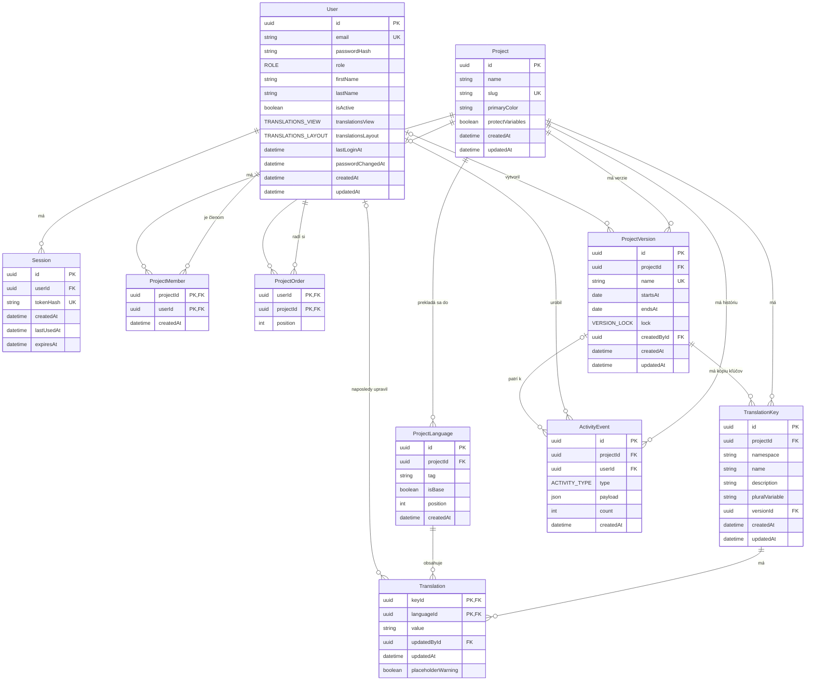

# Databáza

PostgreSQL 17, Prisma 7 s driver adapterom `@prisma/adapter-pg`. Schéma je v `backend/prisma/schema.prisma`, konfigurácia Prisma CLI v `backend/prisma.config.ts` (načíta root `.env`, už nastavené premenné majú prednosť). Prisma klient sa generuje do `backend/src/generated/prisma` (nie je v gite).

## Dátový model

### User

| Pole                     | Typ                        | Poznámka                                                                                                                                                                                                              |
| ------------------------ | -------------------------- | --------------------------------------------------------------------------------------------------------------------------------------------------------------------------------------------------------------------- |
| `id`                     | UUID                       | PK                                                                                                                                                                                                                    |
| `email`                  | string, unique             | uložený normalizovaný (`trim()` + malé písmená)                                                                                                                                                                       |
| `passwordHash`           | string                     | argon2id, nikdy sa nevracia v API                                                                                                                                                                                     |
| `role`                   | enum `ROLE`                | `ADMIN`, `MANAGER` (práva `ADMIN`-a vo svojich projektoch, bez správy), `EDITOR` alebo `VISITOR` (iba číta a exportuje), default `EDITOR`; nastavuje ho `POST /api/admin/users` (jediná cesta, ako používateľ vzniká) |
| `firstName`, `lastName`  | string, nullable           | upravuje ich používateľ na obrazovke Môj profil (`PATCH /api/profile`)                                                                                                                                                |
| `isActive`               | boolean                    | default `true`, neaktívny user sa neprihlási                                                                                                                                                                          |
| `translationsView`       | enum `TRANSLATIONS_VIEW`   | `EXTENDED` (default, všetky jazyky vedľa seba) alebo `COMPACT` (zdrojový → cieľový); preferencia stránky Preklady, mení `PATCH /api/profile/preferences`                                                              |
| `translationsLayout`     | enum `TRANSLATIONS_LAYOUT` | `COLUMNS` (default, jazyky vedľa seba) alebo `STACKED` (pod sebou); preferencia stránky Preklady, mení `PATCH /api/profile/preferences`                                                                               |
| `lastLoginAt`            | datetime, nullable         | nastaví sa pri úspešnom logine                                                                                                                                                                                        |
| `passwordChangedAt`      | datetime                   | default čas vytvorenia                                                                                                                                                                                                |
| `createdAt`, `updatedAt` | datetime                   |                                                                                                                                                                                                                       |

### Session

Server-side session pre prihlásenie. Jeden riadok = jedno prihlásenie v jednom prehliadači. Správanie API je v [API: auth](./api/auth.md).

| Pole         | Typ            | Poznámka                                                                                   |
| ------------ | -------------- | ------------------------------------------------------------------------------------------ |
| `id`         | UUID           | PK                                                                                         |
| `userId`     | UUID           | FK na `User`, pri zmazaní usera sa zmaže                                                   |
| `tokenHash`  | string, unique | SHA-256 (hex) tokenu z cookie `locale_session`; samotný token sa neukladá                  |
| `createdAt`  | datetime       | čas prihlásenia, od neho sa počíta absolútny limit `SESSION_MAX_AGE_DAYS` (default 30 dní) |
| `lastUsedAt` | datetime       | posledná zapísaná aktivita; zapisuje sa najviac raz za 5 minút                             |
| `expiresAt`  | datetime       | `min(lastUsedAt + SESSION_TTL_DAYS, createdAt + SESSION_MAX_AGE_DAYS)`, default TTL 7 dní  |

Životný cyklus:

- **Login** vytvorí riadok (`createdAt = lastUsedAt = teraz`) a zmaže všetky riadky s `expiresAt` v minulosti.
- **Požiadavka s prihlásením:** ak od `lastUsedAt` prešlo aspoň 5 minút, nastaví sa `lastUsedAt = teraz` a prepočíta `expiresAt`. Inak sa do DB nezapisuje.
- **Expirácia:** session s `expiresAt` v minulosti alebo staršia ako absolútny limit sa pri použití zmaže (401). Rovnako session neaktívneho usera.
- **Logout** zmaže riadok aktuálnej session, ostatné session usera ostanú.

Indexy: `userId`, `expiresAt`.

### ProjectLanguage

Jazyk projektu, do ktorého sa projekt prekladá. Ukladá sa iba tag, anglický a pôvodný názov a vlajku dopĺňa backend z katalógu `SUPPORTED_LANGUAGES` v `packages/shared` (upraviť sa nedajú). Správanie API je v [API: jazyky projektu](./api/project-languages.md).

| Pole        | Typ      | Poznámka                                                                                                                                                                                                                           |
| ----------- | -------- | ---------------------------------------------------------------------------------------------------------------------------------------------------------------------------------------------------------------------------------- |
| `id`        | UUID     | PK                                                                                                                                                                                                                                 |
| `projectId` | UUID     | FK na `Project`, pri zmazaní projektu sa zmaže                                                                                                                                                                                     |
| `tag`       | string   | tag z katalógu (`sk`, `en`, `de-AT`, ...), v projekte unikátny                                                                                                                                                                     |
| `isBase`    | boolean  | default `false`, základný jazyk projektu; prvý jazyk projektu je základný                                                                                                                                                          |
| `position`  | int      | default `0`, poradie stĺpcov v prekladoch (drag and drop na stránke Jazyky); základný jazyk sa zobrazí vždy prvý, pri zhode rozhoduje `tag`. Migrácia `language_position` doplnila doterajšie poradie (základný, potom podľa tagu) |
| `createdAt` | datetime |                                                                                                                                                                                                                                    |

Indexy: unikátna dvojica (`projectId`, `tag`) a čiastočný unikátny index `ProjectLanguage_projectId_isBase_key` na `projectId` s podmienkou `WHERE "isBase"`, ktorý zaručí najviac jeden základný jazyk v projekte. Prisma ho v `schema.prisma` nevie vyjadriť, je ručne pridaný v migrácii `project_languages`.

Zápisy, ktoré čítajú alebo presúvajú príznak `isBase` (pridanie, odobratie, zmena poradia, zmena základného jazyka v nastaveniach cez `setBaseLanguage`), zamknú v transakcii riadok projektu (`SELECT … FOR UPDATE`). Pri READ COMMITTED by inak súbežné požiadavky v jednom projekte narazili na čiastočný index.

Do 2026-10-18 boli jazyky globálne (tabuľka `Language`, spravoval ich ADMIN). Migrácia `project_languages` dala každému existujúcemu projektu kópiu všetkých dovtedajších jazykov aj s príznakom základného jazyka a tabuľku `Language` zmazala.

### Project

Projekt (jeden prekladový hárok). Projekty vytvárajú používatelia na index stránke, seed vytvorí prvý projekt. Správanie API je v [API: projekty a členovia](./api/projects.md).

| Pole                     | Typ            | Poznámka                                                                                                                                                                                                                                              |
| ------------------------ | -------------- | ----------------------------------------------------------------------------------------------------------------------------------------------------------------------------------------------------------------------------------------------------- |
| `id`                     | UUID           | PK                                                                                                                                                                                                                                                    |
| `name`                   | string         | názov projektu, 1 až 100 znakov                                                                                                                                                                                                                       |
| `slug`                   | string, unique | malé písmená, číslice a pomlčky (`b2b-admin`), 1 až 50 znakov                                                                                                                                                                                         |
| `primaryColor`           | string         | `#RRGGBB` veľkými písmenami, default `#E83E8C`; zatiaľ sa iba ukladá                                                                                                                                                                                  |
| `protectVariables`       | boolean        | default `true`, chrániť výrazy `{{ variable }}`: úprava prekladu musí mať rovnaké premenné ako referencia (vetný kľúč s premennými, inak základný jazyk), inak 400 `PLACEHOLDER_MISMATCH` ([API: preklady](./api/translations.md#ochrana-premenných)) |
| `createdAt`, `updatedAt` | datetime       |                                                                                                                                                                                                                                                       |

Každý projekt má vlastné jazyky a vlastný základný jazyk (`ProjectLanguage`).

### ProjectMember

Členstvo používateľa v projekte. Určuje, ktoré projekty vidí `MANAGER`, `EDITOR` a `VISITOR` a ku ktorým majú prístup (`ADMIN` má prístup ku všetkým a členom nie je nikdy: migrácia `add_manager_role` jeho členstvá zmazala, `POST …/members` ho odmietne a zmena roly na `ADMIN` jeho členstvá zmaže). Vzniká pridaním existujúceho používateľa na stránke Členovia alebo na detaile používateľa (iba `ADMIN`); zaniká akciou Opustiť projekt, odobratím členom `ADMIN`-om alebo kaskádou pri zmazaní používateľa či projektu.

| Pole        | Typ      | Poznámka                                       |
| ----------- | -------- | ---------------------------------------------- |
| `projectId` | UUID     | FK na `Project`, pri zmazaní projektu sa zmaže |
| `userId`    | UUID     | FK na `User`, pri zmazaní usera sa zmaže       |
| `createdAt` | datetime | čas pridania do projektu                       |

PK je dvojica (`projectId`, `userId`), index na `userId`. Používateľ má spätnú reláciu `projectMemberships`.

### ProjectOrder

Vlastné poradie projektov jedného používateľa na indexe `/` (drag and drop, `PUT /api/projects/order`). Projekt bez riadku je za ostatnými podľa názvu. `PUT` nahradí všetky riadky používateľa naraz.

| Pole        | Typ  | Poznámka                                       |
| ----------- | ---- | ---------------------------------------------- |
| `userId`    | UUID | FK na `User`, pri zmazaní usera sa zmaže       |
| `projectId` | UUID | FK na `Project`, pri zmazaní projektu sa zmaže |
| `position`  | int  | poradie od 0                                   |

PK je dvojica (`userId`, `projectId`), index na `projectId`. Riadok ostane aj po odchode z projektu (projekt sa používateľovi aj tak nezobrazí). Migrácia `project_order`.

### ProjectVersion

Verzia prekladov projektu: pomenované časové okno zhodné s verziou aplikácie v kóde (`v2.45`). Každá verzia má **vlastnú kópiu kľúčov a buniek** (`TranslationKey.versionId`), vzniká prázdna a naplní ju import (plán [`version-snapshots`](./plans/version-snapshots.md), [ADR 0007](./decisions/0007-version-snapshots.md)). Správanie API je v [API: verzie projektu](./api/project-versions.md), rozhodnutie v [ADR 0006](./decisions/0006-project-versions.md), plán v [`plans/translation-versions.md`](./plans/translation-versions.md).

| Pole                     | Typ                 | Poznámka                                                                                                                         |
| ------------------------ | ------------------- | -------------------------------------------------------------------------------------------------------------------------------- |
| `id`                     | UUID                | PK                                                                                                                               |
| `projectId`              | UUID                | FK na `Project`, pri zmazaní projektu sa zmaže                                                                                   |
| `name`                   | string              | názov zhodný s verziou v kóde, 1 až 50 znakov, unikátny v projekte                                                               |
| `startsAt`               | date                | začiatok okna (code freeze): dokedy vývojári dodajú kľúče                                                                        |
| `endsAt`                 | date                | koniec okna (end of copy + translation): dokedy editori preklady dokončia; vždy po `startsAt`, okná sa môžu prekrývať            |
| `lock`                   | enum `VERSION_LOCK` | default `AUTO` (uzamknutá odo dňa po `endsAt`), `LOCKED` / `UNLOCKED` nastavené ručne `ADMIN`-om majú prednosť pred dátumami     |
| `createdById`            | UUID, nullable      | FK na `User`, kto verziu vytvoril; pri zmazaní usera `null`                                                                      |
| `importedAt`             | datetime, nullable  | čas posledného importu do verzie; `null` = prázdna verzia bez kľúčov. Neskôr poslúži na porovnanie spätných zmien staršej verzie |
| `createdAt`, `updatedAt` | datetime            |                                                                                                                                  |

Indexy: unikátna dvojica (`projectId`, `name`), (`projectId`, `startsAt` DESC) pre zoznam a hľadanie aktuálnej verzie. Dátumy sú `DATE` bez času; Prisma ich vracia ako UTC polnoc, backend ich číta a zapisuje cez `fromDbDate` / `toDbDate` v `backend/src/lib/projectVersions.ts`, „dnes“ je dátum servera.

Kľúče verzie na ňu ukazujú s `Cascade`, takže zmazanie verzie (plánované v míľniku C) zmaže aj jej kľúče a bunky. Uzamknutá verzia (`isVersionLocked` v `packages/shared`: `lock = LOCKED`, alebo `AUTO` a dnešok mimo okna `startsAt`–`endsAt`) blokuje zápisy `EDITOR`-a a `VISITOR`-a (409 `PROJECT_VERSION_LOCKED`), `ADMIN` a `MANAGER` zapisujú vždy. Aktuálna verzia (dnešok medzi dátumami, pri prekryve najneskorší `startsAt`) sa odvodzuje dotazom (`findCurrentVersionId`), neukladá sa; projektové súhrny (zoznam projektov, stránka Jazyky) počítajú predvolenú verziu (`findDefaultVersionId`: aktuálna, inak najnovšia).

### TranslationKey

Kľúč prekladu v jednej verzii projektu: každá verzia drží vlastnú kópiu kľúčov, takže ten istý kľúč existuje raz v každej verzii. Správanie API je v [API: preklady](./api/translations.md).

| Pole                     | Typ              | Poznámka                                                                                |
| ------------------------ | ---------------- | --------------------------------------------------------------------------------------- |
| `id`                     | UUID             | PK                                                                                      |
| `projectId`              | UUID             | FK na `Project`, pri zmazaní projektu sa zmaže; ponechané pre dopyty za projekt (index) |
| `versionId`              | UUID             | FK na `ProjectVersion` (`Cascade`): verzia, ktorej kópia kľúč je; povinné               |
| `namespace`              | string           | default `""`; názov JSON súboru (`loc`, `paths`), v CSV sekcia `--namespace--`          |
| `name`                   | string           | kľúč, napr. veta `Uložiť` alebo cesta `orders.empty.title`                              |
| `description`            | string, nullable | popis kľúča pre prekladateľov, max. 500 znakov                                          |
| `pluralVariable`         | string, nullable | `null` = bežný kľúč; názov číselnej premennej (`count`) = plurálový kľúč                |
| `createdAt`, `updatedAt` | datetime         |                                                                                         |

Unikátna trojica (`versionId`, `namespace`, `name`): ten istý kľúč môže byť vo verzii vo viacerých namespace a v každej verzii projektu raz. Namespace je súčasť identity kľúča a musí sa zachovať presne, lebo budúci export z neho generuje JSON súbory po jazykoch aj sekcie v CSV. V zozname prekladov slúži ako skupina a filter.

Plurálový kľúč (`pluralVariable` nie je `null`) ukladá v každom jazyku jednu ICU správu `{count, plural, one {# položka} few {# položky} other {# položiek}}` (`serializePluralValue` v `packages/shared/src/plurals.ts`). Zapnutie, vypnutie alebo premenovanie premennej cez `PATCH …/keys/:keyId` prepíše hodnoty vo všetkých jazykoch (viď [API: preklady](./api/translations.md#plurálové-formy)).

Kľúče vytvára import alebo `ADMIN` ručne cez `POST /api/projects/:projectId/keys`, vždy do zvolenej verzie a do namespace, ktorý tá verzia už má (nový namespace vzniká iba importom); názov, popis a plurál upraví `ADMIN` cez `PATCH /api/projects/:projectId/keys/:keyId`, člen `EDITOR` iba popis. Dĺžka `name` je obmedzená na 2 000 **bajtov** v UTF-8 (`IMPORT_KEY_MAX_BYTES`, chyba `KEY_TOO_LONG`) a `namespace` na 100 znakov (`IMPORT_NAMESPACE_MAX_LENGTH`), lebo riadok btree indexu unesie najviac ~2,7 kB: 2 000 znakov v cyrilike (≈ 4 kB) by pri zápise skončilo chybou 500. Kľúč s 2 000 bajtmi a 100-znakovým namespace sa do indexu zmestí (overené integračným testom). Zmazanie projektu zmaže kľúče aj preklady kaskádou; kľúče, ktoré v importovanom súbore chýbajú, sa nemažú.

### Translation

Text kľúča v jednom jazyku projektu.

| Pole                 | Typ               | Poznámka                                                                                                                                                                                                                                                                                                                                                                                                                                                                                                                                                                                                                                  |
| -------------------- | ----------------- | ----------------------------------------------------------------------------------------------------------------------------------------------------------------------------------------------------------------------------------------------------------------------------------------------------------------------------------------------------------------------------------------------------------------------------------------------------------------------------------------------------------------------------------------------------------------------------------------------------------------------------------------- |
| `keyId`              | UUID              | FK na `TranslationKey`, pri zmazaní kľúča sa zmaže                                                                                                                                                                                                                                                                                                                                                                                                                                                                                                                                                                                        |
| `languageId`         | UUID              | FK na `ProjectLanguage`, pri odobratí jazyka z projektu sa zmaže                                                                                                                                                                                                                                                                                                                                                                                                                                                                                                                                                                          |
| `value`              | string, nullable  | text prekladu; `null` = nepreložené. `""` sa neukladá (zapíše sa ako `null`)                                                                                                                                                                                                                                                                                                                                                                                                                                                                                                                                                              |
| `updatedById`        | UUID, nullable    | FK na `User`, kto naposledy zmenil preklad; pri zmazaní usera sa nastaví `null`                                                                                                                                                                                                                                                                                                                                                                                                                                                                                                                                                           |
| `updatedAt`          | datetime          | posledná zmena                                                                                                                                                                                                                                                                                                                                                                                                                                                                                                                                                                                                                            |
| `placeholderWarning` | boolean, nullable | `true` = premenné hodnoty sa líšia od [referencie](./api/translations.md#ochrana-premenných) (vetný kľúč s premennými: jeho názov pre všetky jazyky vrátane základného; inak hodnota základného jazyka, prípadne názov kľúča s premennými), `false` = skontrolované a v poriadku (základný jazyk kľúča bez premenných v názve vždy), `null` = ešte nevypočítané; prepočítava sa po kľúčoch v transakcii každého zápisu (úprava, Pridať kľúč, premenovanie, import, zmena základného jazyka) a `null` riadky dopočíta seed pri štarte (`seedPlaceholderWarnings`). Plán [`plans/translation-warnings.md`](./plans/translation-warnings.md) |

PK je dvojica (`keyId`, `languageId`), index na `languageId`; verziu bunky určuje jej kľúč. Kaskády: zmazanie kľúča alebo odobratie jazyka z projektu zmaže jeho preklady, zmazanie používateľa nastaví `updatedById` na `null`.

Riadky zapisujú dva endpointy:

- **Úprava prekladu** (`PUT …/keys/:keyId/translations/:languageId`): jednoriadkový upsert bez zámku (je atomický), `updatedById` je prihlásený používateľ. Prázdny text sa uloží ako `null`.
- **Import** (`POST …/imports`): jedna transakcia (timeout 60 s) so zámkom `pg_advisory_xact_lock(hashtextextended('import:' || projectId, 0))` a `lock_timeout` 30 s, takže súbežné importy jedného projektu idú za sebou a importy rôznych projektov paralelne. Chýbajúce kľúče aj preklady sa zapisujú po dávkach 5 000 riadkov cez `INSERT … SELECT FROM unnest(…)` s `ON CONFLICT DO NOTHING` (kľúče) a `ON CONFLICT DO UPDATE … WHERE value IS DISTINCT FROM EXCLUDED.value` (preklady); `updatedAt` nemá v DB default, SQL ho nastavuje na `now()`. Prázdna hodnota zo súboru nikdy nevytvorí riadok s `null` ani nezmaže vyplnený preklad, rovnaká hodnota sa nezapisuje (viď [API: import](./api/imports.md#transakcia-zámok-a-dávky)).

Stav prekladu sa neukladá. **Nepreložené** = riadok pre jazyk chýba alebo `value` je `null`, inak **Preložené**. Jazyk pridaný do projektu po importe preto nemá žiadne riadky a všetky kľúče sú v ňom nepreložené; nič sa nedopĺňa. Index `pg_trgm` pre vyhľadávanie zatiaľ nie je, 2 500 kľúčov × 10 jazykov zvládne `ILIKE` za približne 10 ms (viď [API: preklady](./api/translations.md#výkon)).

### ActivityEvent

Záznam jednej zmeny projektu pre stránku Prehľad (feed aktivity a graf dennej aktivity) a budúcu stránku Aktivita. Tabuľka je iba na pripisovanie: riadky sa nemenia ani nemažú (okrem kaskády), retencia zatiaľ nie je. Rozhodnutie je v [ADR 0005](./decisions/0005-activity-events.md).

| Pole        | Typ                  | Poznámka                                                                                                                                                                                       |
| ----------- | -------------------- | ---------------------------------------------------------------------------------------------------------------------------------------------------------------------------------------------- |
| `id`        | UUID                 | PK                                                                                                                                                                                             |
| `projectId` | UUID                 | FK na `Project`, pri zmazaní projektu sa zmaže                                                                                                                                                 |
| `userId`    | UUID, nullable       | FK na `User`, kto zmenu urobil; pri zmazaní usera sa nastaví `null`, udalosť ostane                                                                                                            |
| `versionId` | UUID, nullable       | FK na `ProjectVersion` (`SetNull`): verzia, ku ktorej zmena patrí (kľúče, bunky, import, samotná verzia); `null` pri udalostiach projektu a po zmazaní verzie. Index pre denné súčty za verziu |
| `type`      | enum `ACTIVITY_TYPE` | druh zmeny, viď tabuľku nižšie                                                                                                                                                                 |
| `payload`   | JSON                 | snímka údajov v čase zmeny podľa `type`, validovaná schémou `activityEventDataSchema` v `packages/shared/src/activity.ts`                                                                      |
| `count`     | int                  | default `1`; počet zmenených prekladov, ktoré udalosť predstavuje (import = počet zapísaných buniek), z neho sa ráta denný graf                                                                |
| `createdAt` | datetime             | čas zmeny                                                                                                                                                                                      |

Index (`projectId`, `createdAt` DESC) pre feed aj denné súčty.

Udalosť zapisuje helper `recordActivity(tx, …)` (`backend/src/lib/activity.ts`) v **tej istej transakcii** ako zmenu, takže zlyhaná zmena (validácia, konflikt, rollback) nezapíše nič. Payload je snímka (tag jazyka, namespace a názov kľúča, meno a e-mail člena, stará a nová hodnota), aby feed ostal čitateľný aj po zmazaní kľúča, jazyka alebo používateľa.

| `type`                  | Kedy sa zapíše                                                                                                         | `payload`                                                                                 |
| ----------------------- | ---------------------------------------------------------------------------------------------------------------------- | ----------------------------------------------------------------------------------------- |
| `PROJECT_CREATED`       | `POST /api/projects`                                                                                                   | `{ name }`                                                                                |
| `PROJECT_UPDATED`       | `PATCH …/settings`, iba ak sa zmenilo aspoň jedno pole                                                                 | `{ fields }` – zmenené z `name`, `slug`, `primaryColor`, `protectVariables`               |
| `LANGUAGE_ADDED`        | `POST …/languages`                                                                                                     | `{ tag }`                                                                                 |
| `LANGUAGE_REMOVED`      | `DELETE …/languages/:languageId`                                                                                       | `{ tag }`                                                                                 |
| `BASE_LANGUAGE_CHANGED` | základný jazyk sa naozaj zmenil: `baseLanguageId` v `PATCH …/settings` alebo nový prvý jazyk v `PUT …/languages/order` | `{ fromTag, toTag }` (`fromTag` je `null`, ak projekt základný jazyk nemal)               |
| `MEMBER_ADDED`          | `POST …/members`                                                                                                       | `{ member: { id, firstName, lastName, email } }`                                          |
| `MEMBER_REMOVED`        | `DELETE …/members/:userId` aj `DELETE …/membership` (odchod)                                                           | `{ member, left }` – `left` je `true`, keď člen odišiel sám                               |
| `KEYS_IMPORTED`         | `POST …/imports`, ak vytvoril kľúč alebo zapísal hodnotu; jedna udalosť za import                                      | `{ keysCreated, translationsCreated, translationsUpdated, languageTags }`                 |
| `KEY_CREATED`           | `POST …/keys` (ručné pridanie kľúča)                                                                                   | `{ keyId, namespace, name, languageTags }` – jazyky s vyplnenou hodnotou                  |
| `KEY_UPDATED`           | `PATCH …/keys/:keyId`, iba ak sa zmenil názov, popis alebo plurál                                                      | `{ keyId, namespace, name, fields }` – `name` je nový názov                               |
| `TRANSLATION_UPDATED`   | `PUT …/translations/:languageId`, iba ak sa uložená hodnota zmenila                                                    | `{ keyId, namespace, name, languageTag, oldValue, newValue }` (`null` = prázdne)          |
| `VERSION_CREATED`       | `POST …/versions`                                                                                                      | `{ name, startsAt, endsAt }`                                                              |
| `VERSION_UPDATED`       | `PATCH …/versions/:versionId`, iba ak sa zmenilo aspoň jedno pole                                                      | `{ name, fields }` – zmenené z `name`, `startsAt`, `endsAt`, `lock`; `name` je nový názov |
| `VERSION_DELETED`       | `DELETE …/versions/:versionId`                                                                                         | `{ name, keyCount }` – názov a počet zmazaných kľúčov                                     |

Pri `KEYS_IMPORTED` je `count` počet zapísaných buniek (`translationsCreated + translationsUpdated`), `languageTags` sú jazyky, do ktorých sa niečo zapísalo, v poradí projektu. Import, ktorý iba zmení existujúce kľúče na plurálové (bez novej hodnoty a nového kľúča), sa nezaznamenáva. Nezaznamenáva sa ani zmena poradia jazykov (ak nemení základný jazyk) ani projektov, zmazanie projektu ADMIN-om (kaskáda zmaže aj udalosti) a zmeny používateľov.

Migrácia `activity_event` doplnila každému existujúcemu projektu jednu udalosť `PROJECT_CREATED` s časom `Project.createdAt` a autorom podľa najstaršieho člena (alebo `null`). Iné spätné doplnenie nie je: `Translation.updatedAt` drží iba poslednú zmenu bunky a graf by klamal.

## Migrácie

Migrácie sú v `backend/prisma/migrations/` a commitujú sa do gitu.

| Príkaz (z rootu)  | Čo robí                                                                  |
| ----------------- | ------------------------------------------------------------------------ |
| `pnpm db:migrate` | `prisma migrate dev` (vytvorí a aplikuje migráciu v dev DB) a potom seed |
| `pnpm db:seed`    | iba seed                                                                 |
| `pnpm db:reset`   | zmaže lokálnu DB, aplikuje všetky migrácie a spustí seed                 |

Nová migrácia: zmeň `schema.prisma` a spusti `pnpm --filter backend exec prisma migrate dev --name <nazov>`.

Rozšírenia PostgreSQL: `unaccent` (migrácia `search_unaccent`) pre vyhľadávanie prekladov bez ohľadu na diakritiku. Je „trusted“, takže ho vytvorí aj vlastník databázy bez superusera; v `schema.prisma` nie je, Prisma ho nesleduje.

V produkčnom stacku backend pri štarte spustí `prisma migrate deploy`, potom seed a až potom server (`docker/backend-entrypoint.sh`, server spúšťa cez `exec`, aby dostal SIGTERM). Mimo Dockera robí to isté skript `start:prod`.

## Seed

Seed (`backend/prisma/seed.ts`) vytvorí admina `michal.bella@goodrequest.com` s rolou `ADMIN`, projekt `B2B Admin` s jazykmi `sk` (základný) a `en` a v ňom vzorové preklady.

- Heslo je z ENV `SEED_ADMIN_PASSWORD` a musí spĺňať pravidlá hesla z `packages/shared` (8 až 128 znakov). Ak chýba alebo je nevalidné, seed skončí s chybou a nič nevytvorí.
- Seed je idempotentný: ak admin s týmto emailom existuje, nemení nič (ani heslo, ani rolu). Zmena `SEED_ADMIN_PASSWORD` v `.env` existujúceho admina neovplyvní. Lokálne sa admin obnoví cez `pnpm db:reset`.
- Projekt `B2B Admin` so slugom `b2b-admin` (farba a ochrana premenných z defaultov) seed vytvorí iba do prázdnej tabuľky `Project` s jazykmi `sk` (základný) a `en` a jeho jediným členom urobí seedovaného admina. Ak projekt existuje, nemení nič, takže zmeny ADMIN-a v nastaveniach projektu ostanú aj po reštarte.
- Preklady: 30 vymyslených kľúčov v namespace `loc` a `paths` (vety, kľúče-cesty ako `orders.empty.title`, premenné `{{count}}`, HTML `<strong>`), časť v `en` nepreložená (chýbajúci riadok aj `null`). Vzniknú iba v tom istom behu (a transakcii), ktorý vytvára projekt `b2b-admin`. Do projektu, ktorý už existuje, seed nikdy nič nepridá (ani do reálneho projektu bez kľúčov, napr. v produkcii), takže v staršej lokálnej DB sa vzorové preklady objavia až po `pnpm db:reset`.
- Aktivita: v tom istom behu vzniknú vymyslené udalosti seedovaného admina za posledných 30 dní (vytvorenie projektu, prvý import, úpravy prekladov, nastavení a kľúča, niektoré dni bez zmien), aby mal Prehľad lokálne dáta. Rovnako iba s novým projektom, v staršej lokálnej DB až po `pnpm db:reset`.

## Test databáza

Integračné testy bežia voči `locale_test` v tom istom Postgres kontajneri (`TEST_DATABASE_URL`). Ak názov DB nekončí na `_test`, testy sa nespustia. Podrobnosti v [Testovanie](./testing.md).
