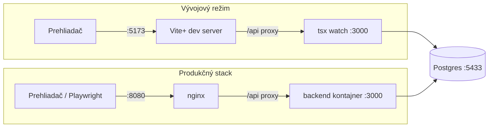

# Lokálny vývoj

## Požiadavky

- macOS alebo Linux
- Docker Desktop (alebo Docker Engine s Compose v2)
- Node podľa `.nvmrc` (`nvm use`)
- pnpm cez corepack (`corepack enable`), verzia je zafixovaná v `package.json` (`packageManager`)

## Prvé spustenie

```bash
cp .env.example .env
pnpm install
```

`.env.example` obsahuje iba lokálne hodnoty (vrátane dev hesla admina), takže po skopírovaní všetko funguje bez úprav.

## Dva režimy

|                 | Vývojový režim                                | Produkčný stack                                    |
| --------------- | --------------------------------------------- | -------------------------------------------------- |
| Spustenie       | `pnpm db:up && pnpm db:migrate && pnpm dev`   | `pnpm stack:up`                                    |
| DB              | Docker, `localhost:5433`                      | Docker, `localhost:5433`                           |
| BE              | lokálne, `tsx watch`, `http://localhost:3000` | kontajner, `http://localhost:3001` (iba debug)     |
| FE              | lokálne, Vite+ s HMR, `http://localhost:5173` | nginx so zbuildovanou SPA, `http://localhost:8080` |
| Migrácie a seed | `pnpm db:migrate` (spustí aj seed)            | automaticky pri štarte BE kontajnera               |
| Na čo           | každodenný vývoj, unit a integračné testy     | smoke testy, E2E, akceptačné kritériá              |

Oba režimy zdieľajú tú istú DB. Porty sa nebijú, takže môžu bežať naraz.

FE aj BE sú v oboch režimoch na jednom origine: vo vývoji Vite proxy presmeruje `/api` na `localhost:3000`, v stacku nginx presmeruje `/api` na kontajner `backend`.



## Príkazy

| Príkaz                        | Čo robí                                                    |
| ----------------------------- | ---------------------------------------------------------- |
| `pnpm db:up` / `pnpm db:down` | spustí / zastaví Postgres                                  |
| `pnpm db:migrate`             | `prisma migrate dev` + seed                                |
| `pnpm db:seed`                | iba seed (idempotentný)                                    |
| `pnpm db:reset`               | zmaže DB, aplikuje migrácie a spustí seed                  |
| `pnpm stack:up`               | zbuilduje a spustí celý stack, čaká na zelené healthchecky |
| `pnpm stack:down`             | zastaví stack (dáta v DB ostanú)                           |
| `pnpm stack:logs [služba]`    | logy (`db`, `backend`, `frontend`)                         |

## ENV premenné

| Premenná                                            | Kde              | Popis                                                                 |
| --------------------------------------------------- | ---------------- | --------------------------------------------------------------------- |
| `DB_PORT`                                           | compose          | port Postgresu na hoste (default `5433`, `5432` býva obsadený)        |
| `POSTGRES_USER`, `POSTGRES_PASSWORD`, `POSTGRES_DB` | compose          | prístup do lokálnej DB                                                |
| `DATABASE_URL`                                      | BE, Prisma       | pripojenie k DB z hosta. V kontajneri ho compose prepíše na host `db` |
| `TEST_DATABASE_URL`                                 | integračné testy | test DB, názov musí končiť na `_test`                                 |
| `NODE_ENV`, `PORT`, `LOG_LEVEL`                     | BE               | prostredie, port, úroveň logovania                                    |
| `SEED_ADMIN_PASSWORD`                               | BE, seed         | heslo admina pre seed, povinné, min. 8 znakov                         |

## Troubleshooting

| Problém                               | Riešenie                                                                                |
| ------------------------------------- | --------------------------------------------------------------------------------------- |
| `Missing .env`                        | `cp .env.example .env`                                                                  |
| port `5433` je obsadený               | zmeň `DB_PORT` v `.env` a port v `DATABASE_URL` / `TEST_DATABASE_URL`                   |
| BE nenaštartuje: chyba ENV            | chýba alebo je neplatná premenná, napr. `SEED_ADMIN_PASSWORD`; chyba vypíše jej názov   |
| `docker compose up` čaká na `backend` | `pnpm stack:logs backend`, najčastejšie migrácia alebo pripojenie k DB                  |
| refresh na hlbokej route vráti 404    | nginx nemá SPA fallback, skontroluj `docker/nginx/default.conf`                         |
| test DB neexistuje                    | vytvorí ju `globalSetup` integračných testov, prípadne `pnpm db:down` a zmazanie volume |
