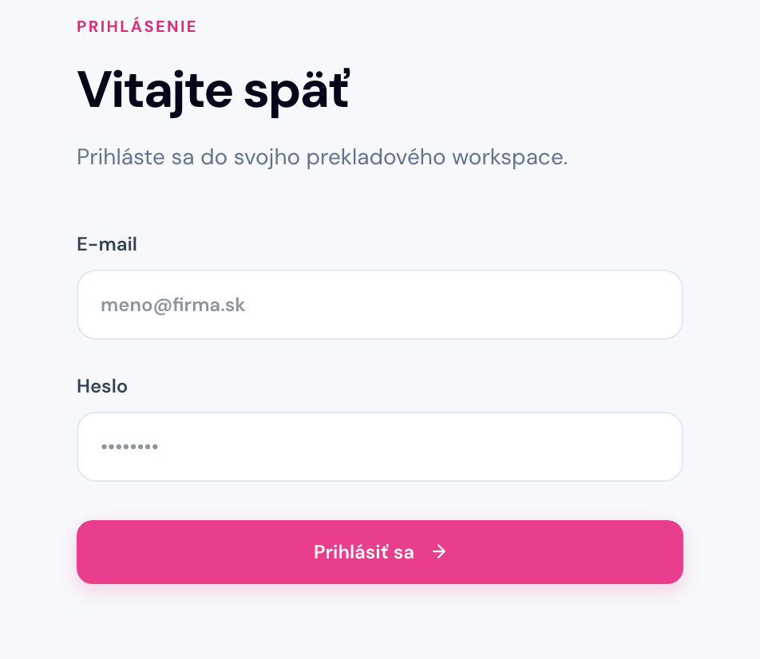
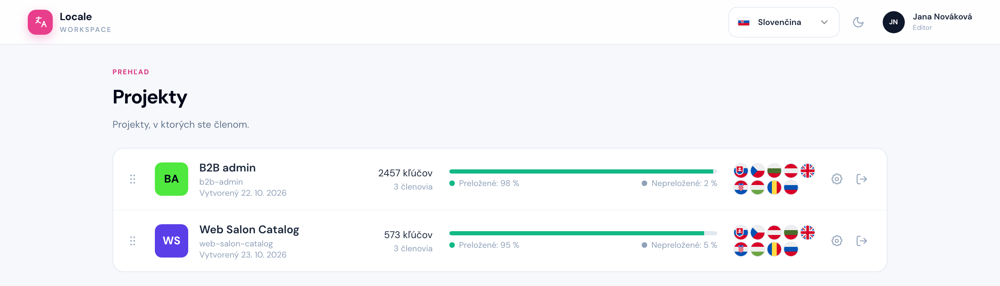
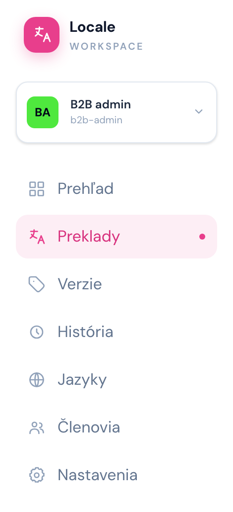
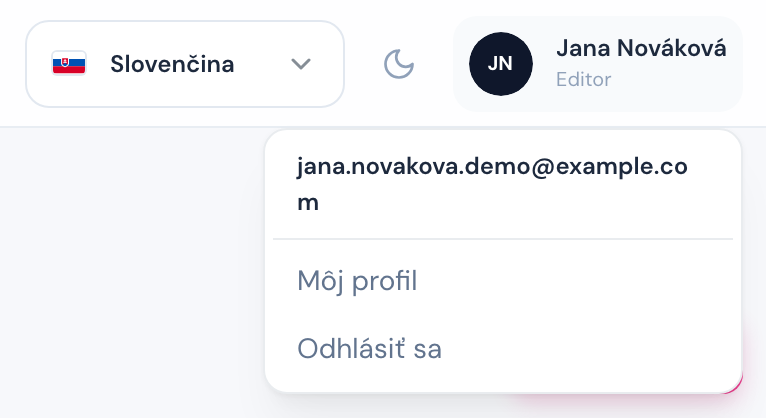

# Úvod: prihlásenie a projekty

## Čo je Locale Admin

Locale Admin je miesto, kde žijú všetky texty našich aplikácií vo všetkých jazykoch. Správca projektu do neho dodá nové kľúče (texty), editori ich preložia a hotové preklady si správca stiahne späť do aplikácie.

Pár pojmov, ktoré budete stretávať:

| Pojem                | Význam                                                                                                                                                             |
| -------------------- | ------------------------------------------------------------------------------------------------------------------------------------------------------------------ |
| **Projekt**          | jedna aplikácia alebo jej časť (napr. B2B admin, Web Salon Catalog). Vidíte iba projekty, do ktorých vás pridal admin.                                             |
| **Kľúč**             | jeden text v aplikácii, napr. `orders.empty.title` alebo celá veta `Book an appointment at {salonName}`.                                                           |
| **Preklad**          | hodnota kľúča v jednom jazyku. Prázdna hodnota = **Nepreložené**.                                                                                                  |
| **Základný jazyk**   | jazyk, z ktorého sa prekladá (referenčný text). Určuje ho správca projektu. Väčšinou je to slovenčina, ktorá vzniká priamo pri vývoji softvéru.                    |
| **Namespace**        | skupina kľúčov podľa súboru v kóde (`loc`, `messages`, …). Slúži ako filter, meniť ho netreba.                                                                     |
| **Správca projektu** | manažér projektu (v aplikácii rola **Správca**): spravuje verzie, jazyky, kľúče, import a nastavenia projektu. Kto ním je, uvidíte na [Prehľade](./02-prehlad.md). |
| **Verzia**           | release aplikácie (napr. `v2.45`) s termínom, dokedy treba texty preložiť. Viac v kapitole [Verzie](./05-verzie.md).                                               |

## Prihlásenie

Cesta: `/login`

Účet vám založí administrátor a pošle vám prihlasovací email a heslo. Registrácia ani pozvánky emailom neexistujú. Heslo si po prvom prihlásení zmeňte v **Môj profil**.

## Zoznam projektov

Cesta: `/`

Po prihlásení uvidíte projekty, v ktorých ste členom. Pri každom projekte vidíte počet kľúčov, podiel preložených textov a jazyky projektu. Kliknutím na projekt sa otvorí rovno na obrazovke **Preklady**.

## Rozloženie aplikácie

Keď otvoríte projekt, vľavo je **bočné menu** a hore **horná lišta**.

V bočnom menu je:

- **Prepínač projektu** (karta s názvom projektu) – presun do iného projektu, ostanete na tej istej stránke.
- Stránky projektu: [Prehľad](./02-prehlad.md), [Preklady](./03-preklady.md), [Verzie](./05-verzie.md), [História](./06-historia.md), [Jazyky](./07-jazyky.md), [Členovia](./08-clenovia.md) a [Nastavenia](./09-nastavenia.md). Každá má v tejto príručke vlastnú kapitolu.
- Šípka dole menu zbalí na ikony, aby ostalo viac miesta na tabuľku.

V hornej lište vpravo je jazyk aplikácie (mení iba texty rozhrania, nie preklady), prepínač svetlého a tmavého režimu a vaše meno. Klik na meno otvorí menu s odkazom **Môj profil** (meno a zmena hesla) a **Odhlásiť sa**.

