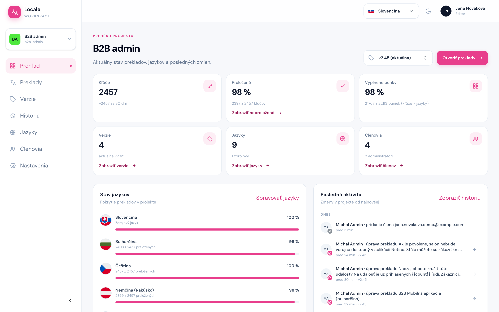

# Prehľad

Cesta: `/projects/{projectSlug}/dashboard`

Stránka **Prehľad** ukazuje stav projektu na jednom mieste. Vpravo hore vyberiete **verziu**, za ktorú sa počítajú karty a graf, a tlačidlom **Otvoriť preklady** prejdete na obrazovku Preklady.

- **Karty** (za zvolenú verziu, okrem počtov verzií, jazykov a členov):
    - **Kľúče** – počet kľúčov vo verzii, pod ním koľko pribudlo za posledných 30 dní.
    - **Preložené** – podiel kľúčov, ktoré majú text vo všetkých jazykoch, napríklad „2397 z 2457 kľúčov“. Odkaz **Zobraziť nepreložené** otvorí Preklady s filtrom nepreložených kľúčov.
    - **Vyplnené bunky** – podiel vyplnených prekladov (kľúče × jazyky). Na rozdiel od karty Preložené ráta každý jazyk zvlášť, takže ukáže pokrok aj pri kľúčoch, ktorým chýba posledný jazyk.
    - **Verzie** – počet verzií projektu a ktorá je aktuálna, odkaz **Zobraziť verzie**.
    - **Jazyky** – počet jazykov projektu, odkaz **Zobraziť jazyky**.
    - **Členovia** – počet ľudí v projekte a koľkí z nich sú administrátori, odkaz **Zobraziť členov**.
- **Stav jazykov** – percento preloženia každého jazyka. Je to najrýchlejší spôsob, ako zistiť, koľko vo vašom jazyku ešte chýba: klik na riadok jazyka otvorí Preklady s filtrom nepreložených kľúčov práve pre tento jazyk.
- **Posledná aktivita** – posledných 10 zmien v projekte s odkazom na celú [Históriu](./06-historia.md).
- **Denná aktivita** – graf zmien po dňoch za 7, 30 alebo 90 dní a najaktívnejší členovia.
