# Preklady

Cesta: `/projects/{projectSlug}/translations`

Obrazovka **Preklady** je tabuľka všetkých kľúčov jednej verzie projektu. Riadok je kľúč, stĺpce sú jazyky.

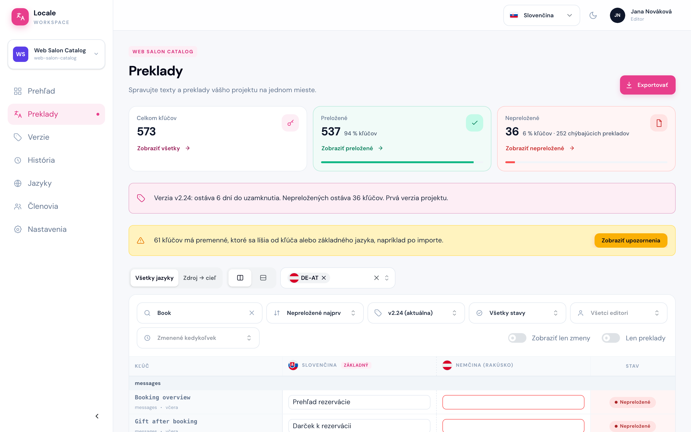

Zhora nadol na nej nájdete:

1. **Štatistiky** – koľko kľúčov je preložených a koľko chýba.
2. **Banner verzie** – do kedy treba preklady dokončiť a čo je nové oproti minulej verzii.
3. **Banner upozornení** (žltý) – iba keď niektoré preklady majú problém s premennými. Tomu má zabrániť správca projektu už pri importe textov, takže opravovať to väčšinou nebude práca editora.
4. **Ovládanie zobrazenia** – ako tabuľka vyzerá.
5. **Filtre** – ktoré kľúče tabuľka ukáže.
6. **Tabuľka** a pod ňou stránkovanie.

Tlačidlo **Exportovať** vpravo hore stiahne preklady do súboru (pozri [Import a export](#import-a-export)).

## Štatistiky

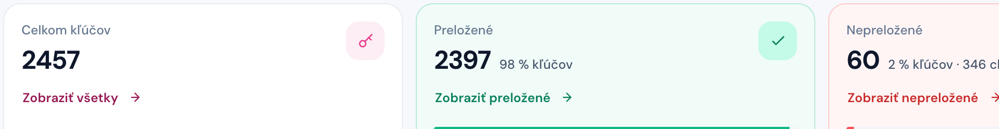

- **Celkom kľúčov** – počet kľúčov vo zvolenej verzii.
- **Preložené** – kľúče, ktoré majú text **vo všetkých jazykoch**.
- **Nepreložené** – kľúče, ktorým chýba aspoň jeden jazyk. Za bodkou je počet chýbajúcich prekladov (prázdnych buniek) spolu.

Odkaz pod číslom (**Zobraziť nepreložené** a pod.) rovno nastaví filter tabuľky, takže uvidíte presne tie kľúče, ktoré karta počíta. Najrýchlejší začiatok práce je **Zobraziť nepreložené**.

## Banner verzie

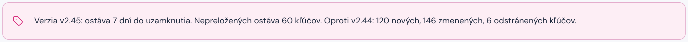

Banner verzie je pre editora najdôležitejšia informácia na stránke. Hovorí:

- **koľko dní ostáva do uzamknutia** zvolenej verzie – dokedy treba preklady dokončiť,
- **koľko kľúčov je ešte nepreložených**,
- **čo sa zmenilo oproti predchádzajúcej verzii** – koľko kľúčov pribudlo, zmenilo sa a bolo odstránených.

Po termíne sa verzia **uzamkne** a preklady v nej už neupravíte: bunky sa neotvoria a banner zmodrie s textom „je uzamknutá“. Ak potrebujete v uzamknutej verzii ešte niečo preložiť alebo opraviť, požiadajte [správcu projektu](./02-prehlad.md) o odomknutie. Viac v kapitole [Verzie](./05-verzie.md).

## Zobrazenie tabuľky

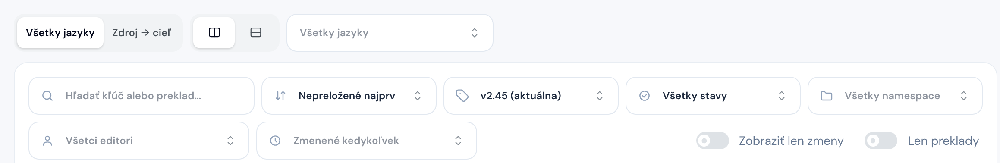

Nad tabuľkou si nastavíte, ako má vyzerať. Voľba sa uloží k vášmu účtu a platí aj na inom počítači.

- **Všetky jazyky** – každý jazyk projektu má vlastný stĺpec. Vhodné na kontrolu, či kľúču nechýba niektorý jazyk.
- **Zdroj → cieľ** – iba dva jazyky vedľa seba: zdrojový (zvyčajne základný) a ten, do ktorého prekladáte. Vhodné, keď prekladáte jeden jazyk. Štatistiky a stav riadku sa vtedy počítajú iba pre cieľový jazyk.

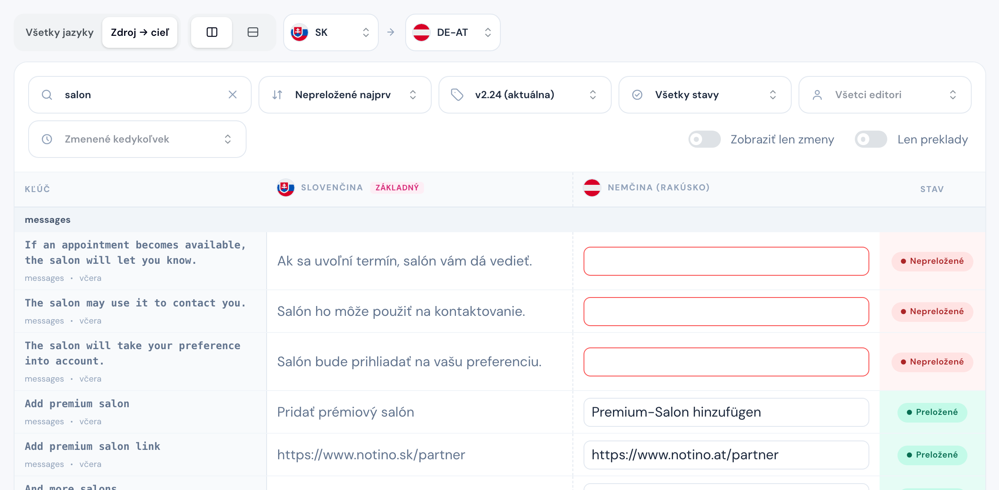

- **Rozloženie** (dve ikony vedľa) – jazyky **vedľa seba** v stĺpcoch, alebo **pod sebou** v jednej bunke. Pod sebou sa hodí na dlhé texty a na menšiu obrazovku.

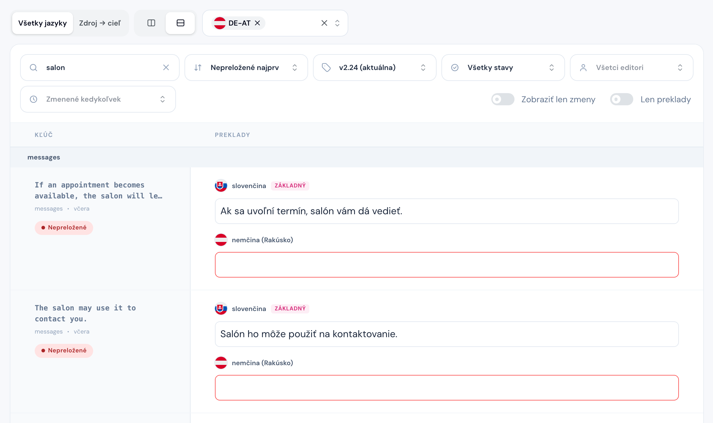

- **Zobrazené jazyky** (v zobrazení Všetky jazyky) – vyberiete iba jazyky, ktoré vás zaujímajú. Základný jazyk sa ukazuje vždy.
- Stĺpec jazyka sa dá rozšíriť ťahaním za pravý okraj hlavičky (po obnovení stránky sa vráti).

## Filtre

| Filter                        | Čo robí                                                                                     |
| ----------------------------- | ------------------------------------------------------------------------------------------- |
| **Hľadať kľúč alebo preklad** | hľadá v názve kľúča aj v textoch prekladov                                                  |
| **Zoradenie**                 | **Nepreložené najprv** (predvolené), **Podľa kľúča**, **Naposledy upravené**                |
| **Verzia**                    | ktorú verziu projektu práve vidíte, predvolene aktuálnu                                     |
| **Stav**                      | **Preložené** / **Nepreložené**                                                             |
| **Namespace**                 | iba kľúče z jedného súboru (ak ich má projekt viac)                                         |
| **Editor**                    | kľúče, ktoré naposledy upravil daný človek                                                  |
| **Zmenené**                   | kľúče zmenené za posledných 24 hodín, 7 alebo 30 dní                                        |
| **Zobraziť len zmeny**        | iba kľúče nové alebo zmenené oproti predchádzajúcej verzii (pozri [Verzie](./05-verzie.md)) |
| **Len preklady**              | skryje stĺpce Kľúč a Stav, ostanú iba texty (hodí sa na mobil a úzku obrazovku)             |

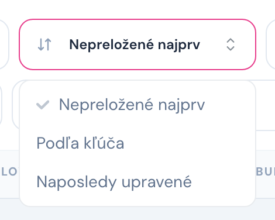

Filtre sú v adrese stránky. Keď kolegovi pošlete odkaz, uvidí presne to isté, čo vy.

Najčastejšie kombinácie:

- **Nepreložené najprv** + filter **Stav: Nepreložené** – čo ešte treba preložiť.
- **Naposledy upravené** + **Zmenené: posledných 24 hodín** – čo sa dnes menilo.
- **Editor** + vaše meno – čo ste upravili vy (alebo kolega, ktorého zastupujete).

## Tabuľka

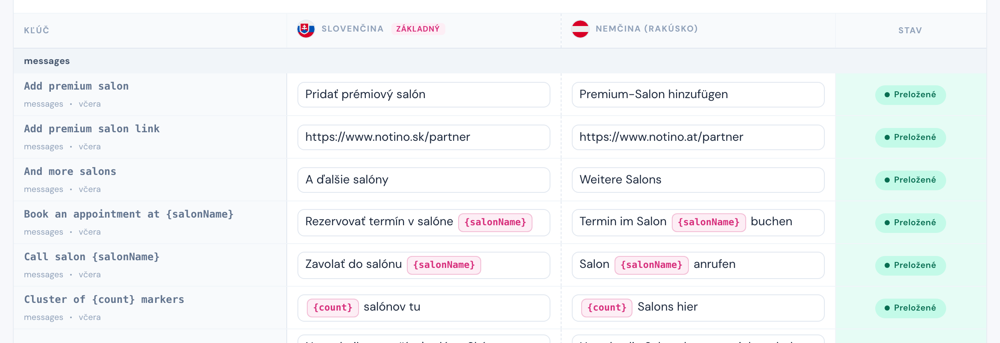

- **Kľúč** – názov kľúča, pod ním namespace a kedy bol naposledy zmenený. Ikona ⓘ za názvom znamená, že kľúč má **popis** – ukáže sa po prejdení myšou. Ikona ceruzky otvorí okno **Upraviť kľúč**, v ktorom môžete [upraviť popis](#popis-kľúča).
- **Stĺpec základného jazyka** má odznak **ZÁKLADNÝ**. Z neho prekladáte.
- **Bunky jazykov** – klik na bunku otvorí [úpravu prekladu](./04-uprava-prekladu.md). Dlhý text je v bunke skrátený na dva riadky, celý ho uvidíte v okne úpravy.
- Ružové štítky v texte (`{salonName}`, `{{day}}`) sú **premenné**, sivé (`<strong>`) sú **HTML značky**. Viac v sekciách [Premenné](./04-uprava-prekladu.md#premenné) a [HTML značky](./04-uprava-prekladu.md#html-značky).
- **Stav** – **Preložené** (zelené), keď má kľúč text vo všetkých jazykoch, inak **Nepreložené** (červené).

Kľúče sú zoskupené podľa prefixu (napr. všetky `day_pluralized.*` pod sebou), sivý riadok je názov skupiny.

### Popis kľúča

Popis je pomocná informácia pre editorov: kde sa text zobrazuje, čo znamenajú premenné, aký dlhý môže byť a podobne. Môže ho napísať správca projektu aj editor, takže keď pri preklade zistíte niečo, čo sa oplatí vedieť ďalšiemu prekladateľovi, doplňte to do popisu.

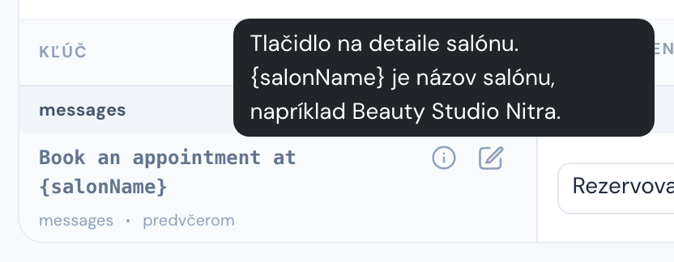

Kliknite na ikonu ceruzky vedľa názvu kľúča. V okne **Upraviť kľúč** meníte iba pole **Popis** (najviac 500 znakov). Samotný kľúč a plurálové nastavenie vidíte iba na čítanie: kľúč zakladá a mení iba správca projektu. V uzamknutej verzii je aj popis iba na čítanie.

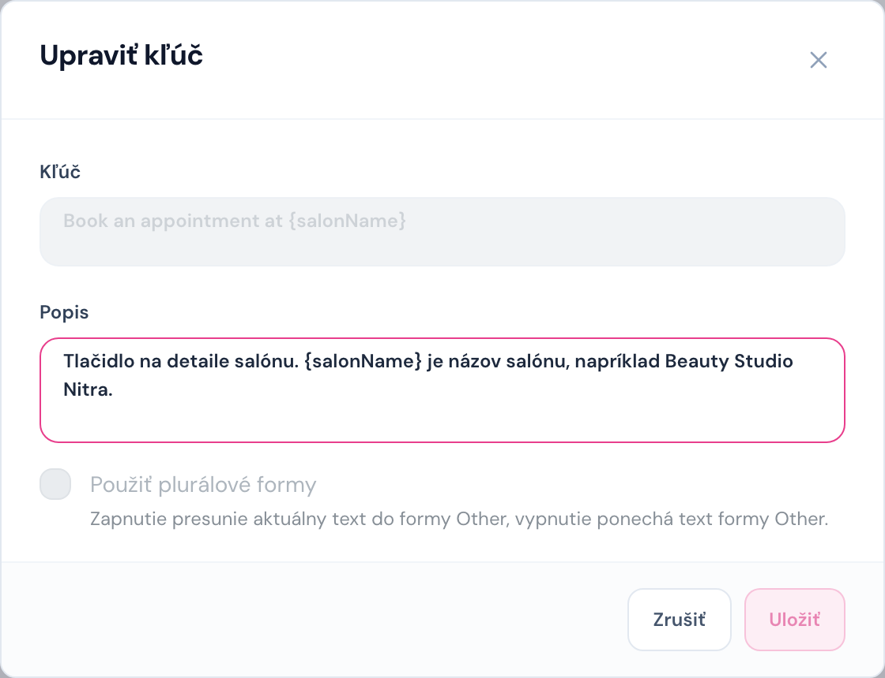

### Nepreložené bunky

Prázdna bunka má **červený rámček**. Pri zoradení **Nepreložené najprv** sú tieto kľúče na začiatku tabuľky.

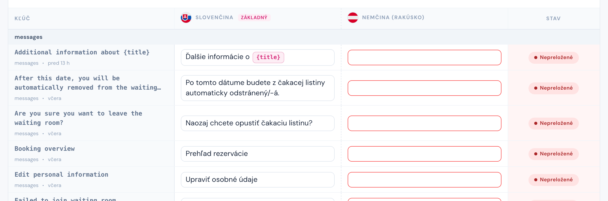

### Upozornenia na premenné

Keď sa premenné v preklade nezhodujú s kľúčom alebo základným jazykom (chýba premenná, alebo je v nej preklep), bunka má **oranžový rámček** a výstražný trojuholník. Žltý banner nad tabuľkou povie, koľko takých kľúčov je, a tlačidlom **Zobraziť upozornenia** vyfiltruje iba ich.

Táto situácia by v praxi nemala nastať. Pri importe textov ju má podchytiť správca projektu a pri úprave prekladu editorom systém nesprávne premenné nedovolí uložiť (pozri [Validácia pri uložení](./04-uprava-prekladu.md#validácia-pri-uložení)). Ak upozornenie predsa uvidíte, dajte vedieť správcovi projektu.

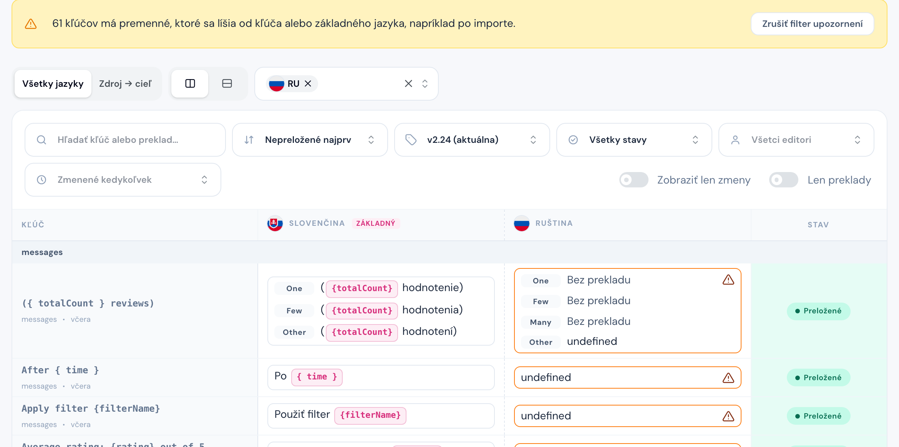

Po prejdení myšou nad bunkou s upozornením tooltip povie, ktorá premenná chýba alebo je navyše:

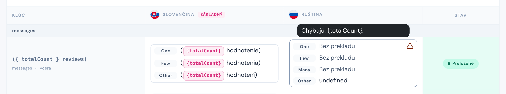

## Stránkovanie

Pod tabuľkou je počet zobrazených kľúčov, prechod medzi stranami (**Predošlá**, čísla strán, **Ďalšia**) a výber **Kľúčov na stranu** (25, 50, 100). Pri väčšom počte kľúčov na stranu prejdete viac textov bez preklikávania, pri menšom sa stránka načíta rýchlejšie. Zmena filtra vždy vráti zoznam na prvú stranu.

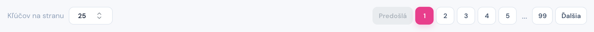

<!-- pagebreak -->

## Import a export

**Import** aj **export** prekladov robí väčšinou správca projektu: importom dodá do verzie nové kľúče a exportom si hotové preklady synchronizuje späť do kódu. Editor tlačidlo **Importovať** nevidí.

**Exportovať** síce vidíte aj vy, ale použite ho len výnimočne, napríklad keď preklady potrebuje človek, ktorý nemá prístup do Locale Admin. Hlavný zmysel aplikácie je, aby každý, kto preklady upravuje, pracoval priamo v nej. Ak niekto, s kým spolupracujete, prístup nemá, požiadajte administrátora, aby mu vytvoril účet a pridal ho do projektu.

V okne exportu vyberiete:

- **Formát** – CSV alebo XLSX (Excel).
- **Jazyky** – ktoré jazyky budú v súbore.
- **Stav** – všetky kľúče, iba preložené alebo iba nepreložené.
- **Len zmeny oproti predchádzajúcej verzii** – iba nové a zmenené kľúče.
- **Názov súboru**.
