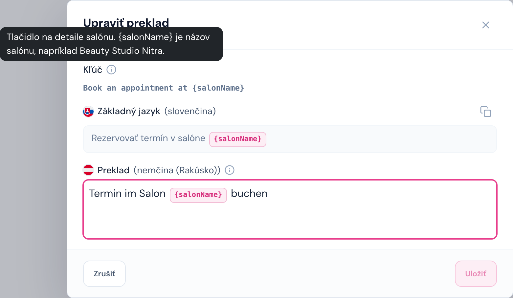
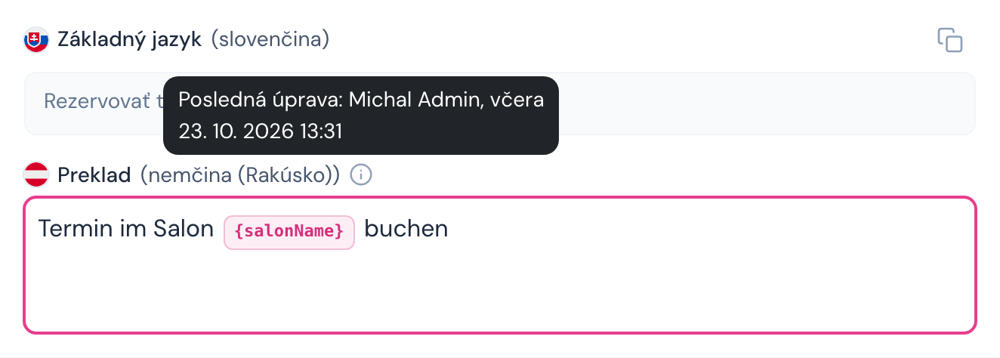
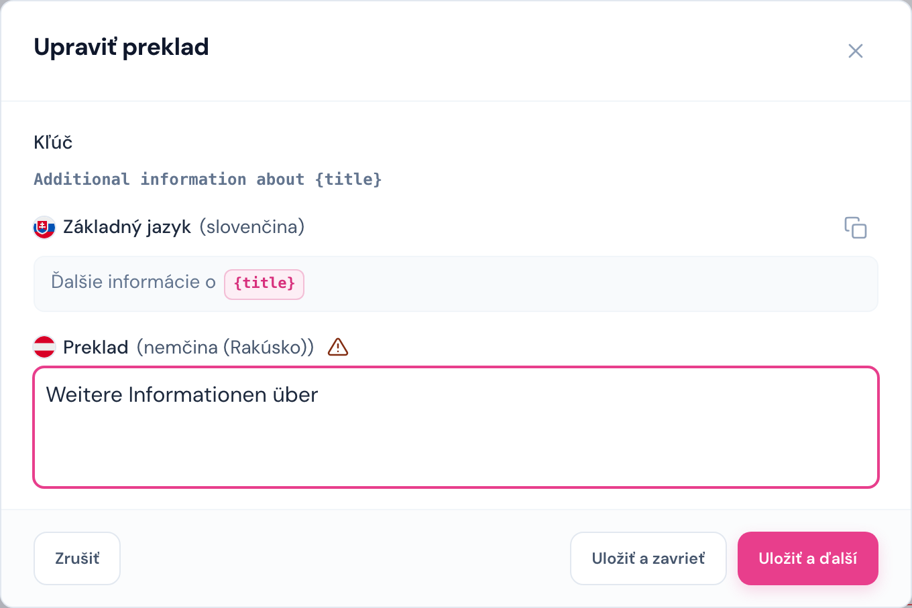
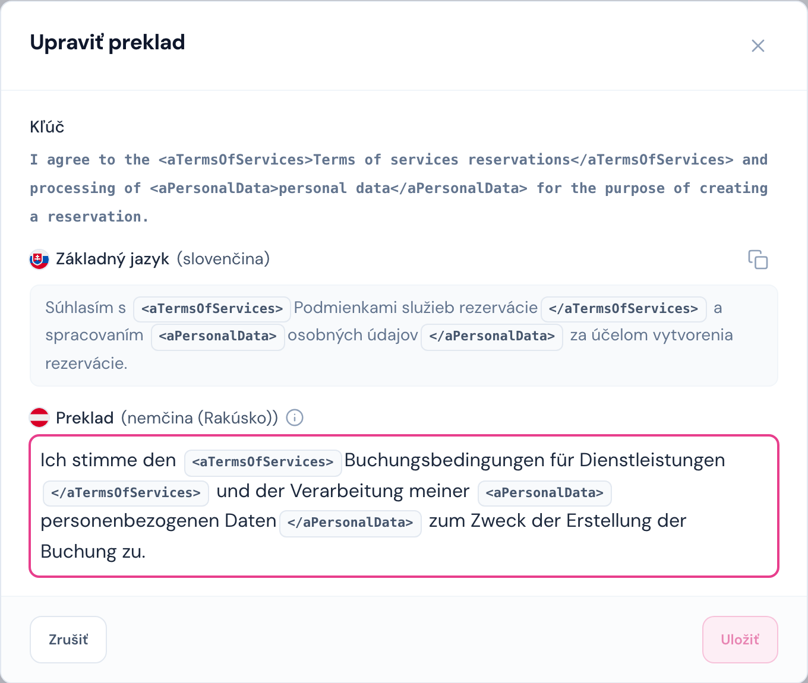
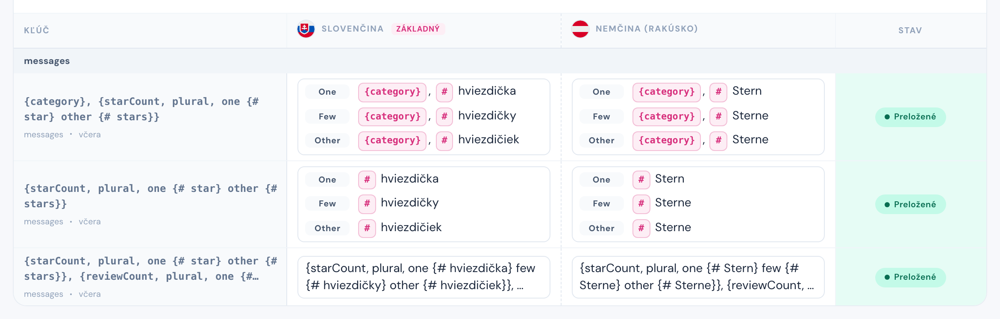
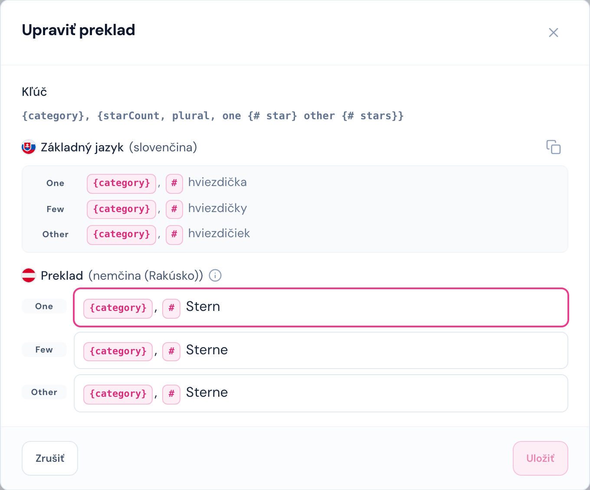
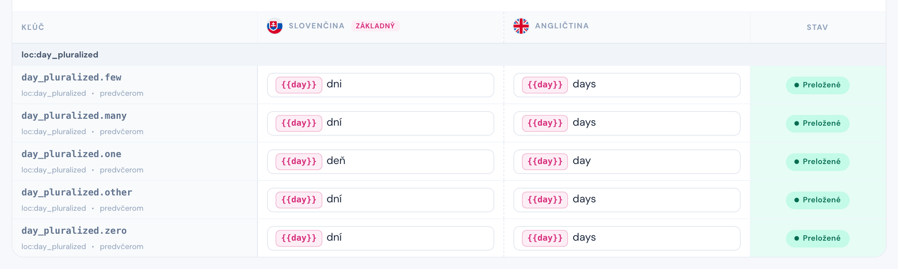
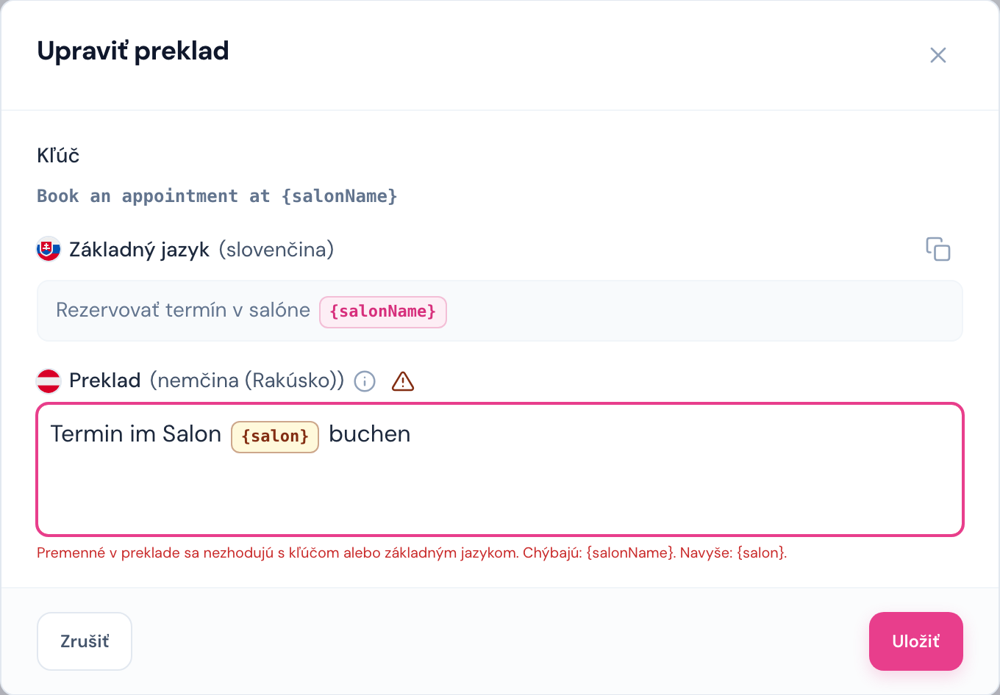
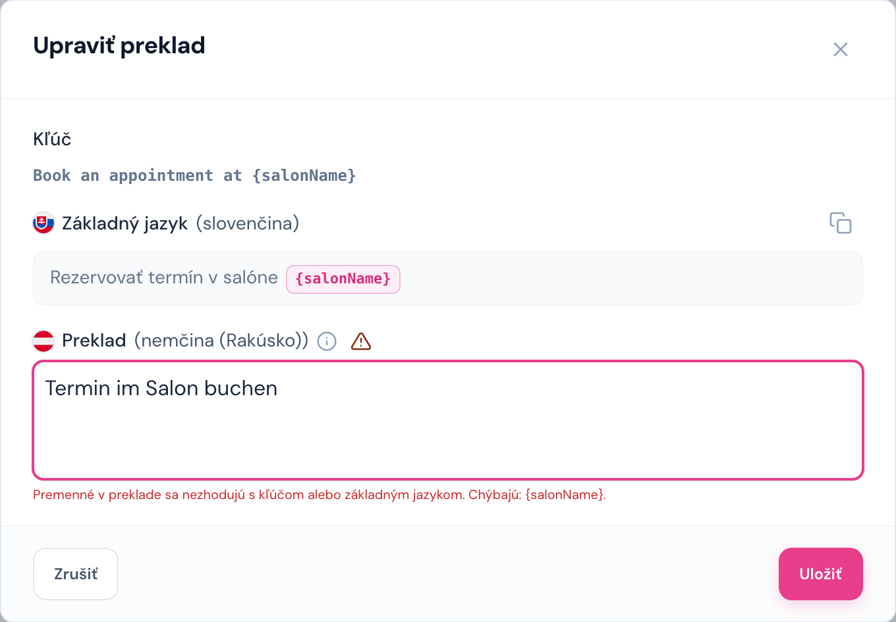

# Úprava prekladu

Cesta: okno na obrazovke Preklady (`/projects/{projectSlug}/translations`)

Preklad upravíte kliknutím na bunku jazyka v tabuľke. Otvorí sa okno **Upraviť preklad**.

V okne je:

- **Kľúč** – názov kľúča. Ak má kľúč [popis](./03-preklady.md#popis-kľúča) (kontext, kde sa text zobrazuje), je za názvom ikona ⓘ a popis sa ukáže po prejdení myšou. Popis upravíte ikonou ceruzky pri kľúči v tabuľke.
- **Základný jazyk** – referenčný text iba na čítanie. Z neho prekladáte.
- Ikona **Prevziať zo základného jazyka** (dva štvorčeky vpravo) – vyplní do poľa prekladu text základného jazyka aj so všetkými premennými a HTML značkami, vy potom prepíšete iba slová. Nič sa pritom neukladá. Odporúčame ňou začať pri každom texte s premennými alebo značkami.
- **Preklad (jazyk)** – pole, do ktorého píšete. Ikona ⓘ pri ňom ukáže, kto a kedy preklad naposledy upravil.

## Uloženie

- **Uložiť** – uloží preklad a zavrie okno. Tlačidlo je aktívne až po zmene textu.
- **Zrušiť**, krížik alebo **Esc** – zavrie okno bez uloženia.
- Prázdny text sa uloží ako **Nepreložené**.
- **Enter** v poli vloží nový riadok, neukladá.

### Uložiť a ďalší

Keď je na aktuálnej strane tabuľky ešte ďalšia nepreložená bunka, okno ponúkne **Uložiť a ďalší**. Uloží preklad a rovno otvorí ďalšiu nepreloženú bunku, takže nemusíte okno stále zatvárať a otvárať. Skratka je **Cmd + Enter** (Mac) alebo **Ctrl + Enter** (Windows).

Tip na rýchlu prácu: zapnite **Zobraziť nepreložené**, v zobrazení **Zdroj → cieľ** vyberte svoj jazyk, otvorte prvú bunku a pokračujte cez **Cmd/Ctrl + Enter**.

### Užitočné vedieť

- **Späť (Ctrl/Cmd + Z) v poli prekladu nefunguje.** Ak sa pomýlite, okno zavrite cez **Zrušiť** a otvorte znova – začnete s uloženou hodnotou.
- Vložený text (Ctrl/Cmd + V) sa vloží bez formátovania.
- Pri bunke zmenenej oproti predchádzajúcej verzii je pod poľom **Zobraziť preklad z v2.44** (pozri [Verzie](./05-verzie.md#čo-sa-zmenilo-oproti-minulej-verzii)).

## Premenné

Premenná je miesto, kam aplikácia doplní hodnotu, napríklad názov salónu alebo počet dní. V projektoch sa stretnete s dvoma zápismi:

| Zápis          | Príklad                                  | Projekt           |
| -------------- | ---------------------------------------- | ----------------- |
| `{premenna}`   | `Rezervovať termín v salóne {salonName}` | Web Salon Catalog |
| `{{premenna}}` | `{{day}} dní`                            | B2B admin         |

Pravidlá:

- **Premennú neprekladajte ani nepremenúvajte.** `{salonName}` ostáva `{salonName}` v každom jazyku.
- **Premenná sa môže posunúť** na iné miesto vo vete, ak to jazyk potrebuje (`Termin im Salon {salonName} buchen`).
- **Žiadna premenná nesmie chýbať ani pribudnúť.** Každá premenná zo základného jazyka musí byť aj v preklade.

V poli prekladu je premenná **zamknutý ružový štítok**: kurzor do neho nevojde a **Backspace** alebo **Delete** ho zmaže celý naraz. Keď premennú omylom zmažete, okno zrušte a otvorte znova.

<!-- pagebreak -->

## HTML značky

Niektoré texty obsahujú HTML značky: tučné písmo `<strong>…</strong>`, odkaz `<aTermsOfServices>…</aTermsOfServices>`, zalomenie riadku ` ` a podobne. Aplikácia podľa nich text naformátuje alebo z časti textu urobí odkaz.

Pravidlá:

- **Značky nechajte v preklade všetky a v rovnakom poradí párov.** Každá otváracia značka (`<aPersonalData>`) musí mať svoju zatváraciu (`</aPersonalData>`).
- **Prekladá sa text medzi značkami**, nie samotné značky. V príklade vyššie sa preloží „Podmienkami služieb rezervácie“, značky `<aTermsOfServices>` okolo ostanú.
- Text medzi značkami môžete v rámci vety presunúť, ak to jazyk potrebuje, ale celý pár musí ostať pokope.
- Značky sú v poli **sivé zamknuté štítky** a správajú sa rovnako ako premenné.

Premenné a značky sa dajú kombinovať, napríklad `Ďalší voľný termín je <button>{ date }</button>`. Platia obe pravidlá naraz: značky ostanú v páre a premenná vnútri ostane nezmenená.

## Plurály

Texty s počtom („1 deň“, „2 dni“, „5 dní“) potrebujú v každom jazyku iný tvar podľa čísla, preto sa prekladajú po **formách**:

| Forma     | Kedy sa použije (zjednodušene)     | Slovenčina / čeština | Ruština          | Angličtina |
| --------- | ---------------------------------- | -------------------- | ---------------- | ---------- |
| **One**   | 1                                  | 1 deň                | 1, 21, 31 …      | 1          |
| **Few**   | malé počty                         | 2 – 4 dni            | 2 – 4, 22 – 24 … | –          |
| **Many**  | veľké počty                        | desatinné čísla      | 5 – 20, 25 …     | –          |
| **Other** | všetko ostatné (vždy povinná)      | 5 a viac dní         | desatinné čísla  | 0, 2, 3 …  |
| **Zero**  | iba ak ju projekt používa pre nulu | 0 dní                | 0 дней           | 0 days     |

Forma **Other** je vždy povinná, aplikácia ju použije, keď iná forma chýba. V projektoch sa stretnete s dvoma zápismi plurálov.

### Plurál v jednom kľúči (Web Salon Catalog)

Kľúč je jedna správa vo formáte ICU, napríklad `{starCount, plural, one {# star} other {# stars}}`. V tabuľke sú formy pod sebou so štítkom formy.

V okne **Upraviť preklad** má každá forma vlastné pole. Formy ponúkne Locale Admin podľa jazyka (slovenčina **One, Few, Other**, angličtina **One, Other**); už uložená forma sa ukáže vždy (na obrázku nemčina s **Few**).

- Štítok **#** je miesto, kam aplikácia doplní číslo. Nechajte ho tam, kde má číslo stáť.
- Vyplňte všetky formy, prázdna forma ostane nepreložená.
- **Prevziať zo základného jazyka** skopíruje každú formu do rovnomennej formy prekladu.

### Plurál ako samostatné kľúče (B2B admin)

V B2B admin je každá forma samostatný kľúč s príponou (`day_pluralized.one`, `.few`, `.many`, `.other`, `.zero`). Nájdete ich vyhľadaním `day_pluralized` a zoradením **Podľa kľúča**.

Každý kľúč prekladáte zvlášť ako bežný text. Vyplňte **všetky** kľúče skupiny aj vtedy, keď váš jazyk danú formu nepoužíva – vtedy do nej dajte rovnaký text ako do formy **Other** (napr. angličtina má `few`, `many` aj `zero` „{{day}} days“).

## Validácia pri uložení

Premenné systém kontroluje dvakrát:

- **Počas písania** – keď preklad obsahuje premennú, ktorú základný jazyk nemá (napríklad preklep `{salon}` namiesto `{salonName}`), štítok zožltne a pri názve jazyka sa objaví výstražný trojuholník. Po prejdení myšou ukáže, čo chýba a čo je navyše.
- **Pri kliknutí na Uložiť** – ak sa premenné nezhodujú s kľúčom alebo základným jazykom, preklad sa **neuloží**. Okno ostane otvorené, pole sa zvýrazní a pod ním sa ukáže, ktorá premenná chýba a ktorá je navyše.

Vľavo je premenná prepísaná na inú, vpravo premenná v preklade chýba:

 

Kontrolu pri uložení zapína vývojár pre každý projekt zvlášť v nastaveniach projektu (ochrana premenných).

Ako sa chybe vyhnúť:

- Začnite ikonou **Prevziať zo základného jazyka**, premenné a značky tak budú v preklade správne a upravíte iba slová.
- S premennými neodporúčame manipulovať. Premennú síce v poli môžete zmazať alebo napísať novú, ale validácia takú zmenu aj tak zachytí a preklad neuloží.
- Ak sa preklad nedarí uložiť ani po úprave textu, ozvite sa vývojárom projektu.

V **uzamknutej verzii** sa bunky vôbec neotvoria (pozri [Verzie](./05-verzie.md)).
