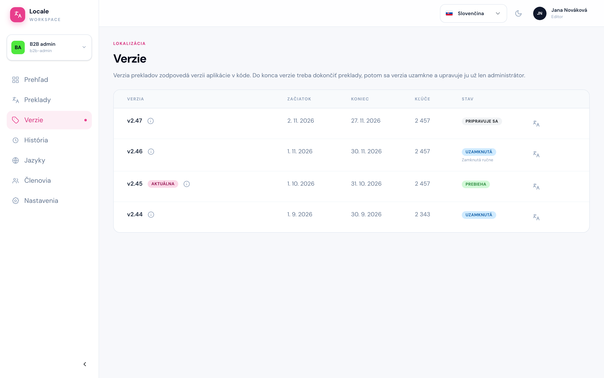

# Verzie

Cesta: `/projects/{projectSlug}/versions`

Stránka **Verzie** je zoznam všetkých verzií projektu od najnovšej. Verzie vytvára, upravuje a zamyká vývojár, editor ich iba vidí.

V tabuľke je pri každej verzii:

- **Verzia** – názov verzie. Aktuálna verzia má odznak **Aktuálna**. Ikona ⓘ ukáže, kto a kedy verziu vytvoril a kedy do nej prebehol import.
- **Začiatok** a **Koniec** – časové okno verzie (pozri nižšie).
- **Kľúče** – počet kľúčov vo verzii, pri verzii bez importu „bez importu“.
- **Stav** – **Pripravuje sa** (ešte nezačala), **Prebieha** (môže sa prekladať) alebo **Uzamknutá** (po termíne). Pod stavom môže byť „Zamknutá ručne“ alebo „Odomknutá na dodatočné úpravy“, keď vývojár stav zmenil ručne.
- Ikona **Otvoriť preklady** vpravo (rovnako ako klik na názov verzie) otvorí obrazovku Preklady s touto verziou.

## Začiatok a koniec verzie

Verzia zodpovedá releasu aplikácie (napr. `v2.45`) a má dva dátumy, ktoré nastavuje vývojár. Dátumy sú pevne dané dopredu podľa sprintov, na ktorých sme sa dohodli:

- **Začiatok** – vývojári dodali nové texty, môže sa prekladať.
- **Koniec** – termín, dokedy majú byť preklady hotové. V tento deň si vývojári preklady synchronizujú s kódom aplikácie. Potom sa verzia **uzamkne** a preklady v nej už editor neupraví.

Ak treba po uzamknutí verzie ešte niečo dodatočne upraviť, informujte vývojára. Verziu odomkne a opravený preklad dostane do kódu pri ďalšej synchronizácii.

Každá verzia má **vlastnú kópiu všetkých kľúčov a prekladov**. Úprava prekladu vo verzii `v2.45` nezmení `v2.44` ani `v2.46`. Preto je dôležité prekladať vo správnej verzii – takmer vždy v **aktuálnej**, ktorá je na Prekladoch predvolená.

## Výber verzie na obrazovke Preklady

Verziu prepnete vo filtri **Verzia** na obrazovke Preklady. Aktuálna verzia má v zátvorke „(aktuálna)“.

Štatistiky, banner verzie aj tabuľka vždy ukazujú zvolenú verziu. Termín a uzamknutie zvolenej verzie ukazuje [banner verzie](./03-preklady.md#banner-verzie).

## Čo sa zmenilo oproti minulej verzii

Prepínač **Zobraziť len zmeny** v lište filtrov ukáže iba kľúče nové alebo zmenené oproti predchádzajúcej verzii – presne to, na čo sa treba v novej verzii pozrieť.

- Nový kľúč má pri názve odznak **Nové**.
- Zmenená bunka má ikonu **⇄** v pravom hornom rohu.
- V okne **Upraviť preklad** zmenenej bunky je pod poľom tlačidlo **Zobraziť preklad z v2.44**. Ukáže predchádzajúci text a prečiarkne, čo z neho zmizlo. Pomôže to pri kontrole, či je zmena správna.

