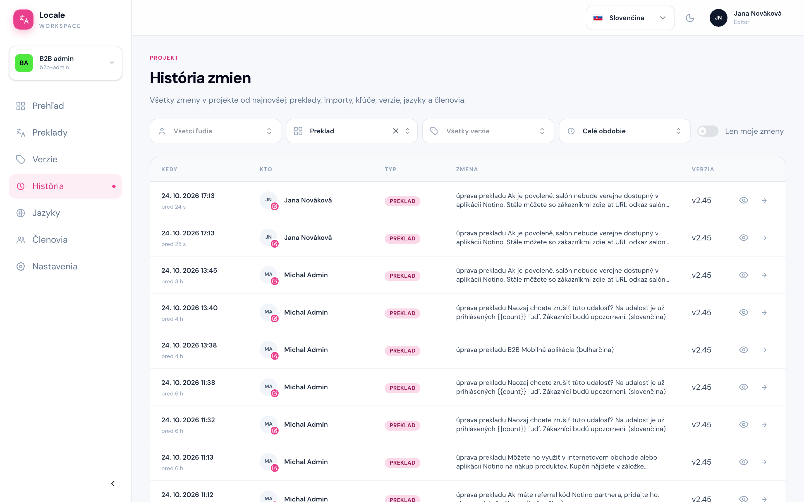
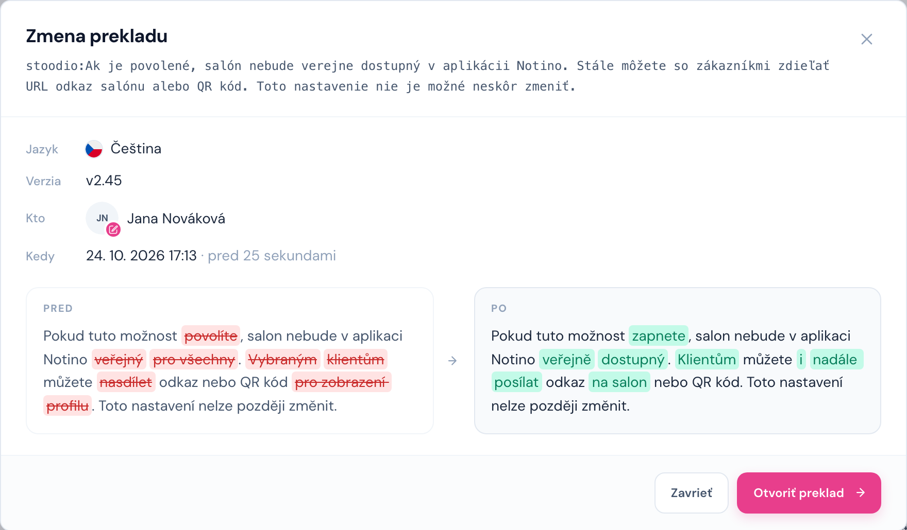

# História

Cesta: `/projects/{projectSlug}/history`

Stránka **História** je zoznam všetkých zmien v projekte od najnovšej: úpravy prekladov, importy, nové kľúče, verzie, jazyky a členovia.

- Filtre **Kto**, **Typ zmeny**, **Verzia** a **Obdobie** zúžia zoznam. Prepínač **Len moje zmeny** ukáže iba vaše úpravy.
- Názov verzie v riadku otvorí preklady tej verzie.
- Šípka vpravo otvorí kľúč na obrazovke Preklady rovno s oknom úpravy.

## Detail zmeny prekladu

Ikona **oka** pri úprave prekladu ukáže, ako text vyzeral **pred** a **po** zmene. Odstránené slová sú prečiarknuté červenou, pridané zvýraznené zelenou.

História sa hodí, keď chcete zistiť, kto a kedy text zmenil, alebo vrátiť pôvodné znenie: skopírujte text z bloku **Pred** a uložte ho v Prekladoch. Tlačidlo **Otvoriť preklad** otvorí rovno okno úpravy tohto prekladu.
