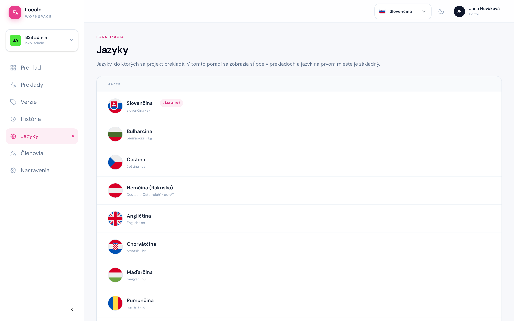

# Jazyky

Cesta: `/projects/{projectSlug}/languages`

Stránka **Jazyky** je zoznam jazykov, do ktorých sa projekt prekladá. Pri každom jazyku je jeho názov, názov v danom jazyku a kód (`sk`, `de-AT`).

- Jazyk na prvom mieste s odznakom **ZÁKLADNÝ** je základný jazyk, z ktorého sa prekladá.
- V tomto poradí sú jazyky aj v stĺpcoch tabuľky na obrazovke Preklady.

Jazyky pridáva, odoberá a mení ich poradie správca projektu. Ak v projekte chýba jazyk, do ktorého máte prekladať, ozvite sa mu.
