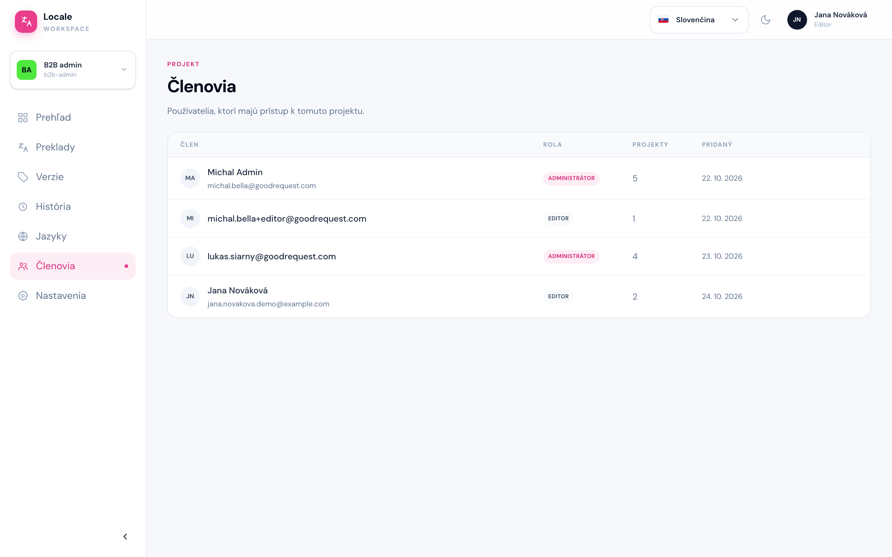

# Členovia

Cesta: `/projects/{projectSlug}/members`

Stránka **Členovia** je zoznam ľudí, ktorí majú prístup k projektu: meno a email, rola (**Administrátor** alebo **Editor**), v koľkých projektoch je člen a kedy bol do projektu pridaný.

Členov pridáva a odoberá administrátor. Stránka sa hodí, keď potrebujete zistiť, kto ešte na projekte pracuje a na koho sa obrátiť.
