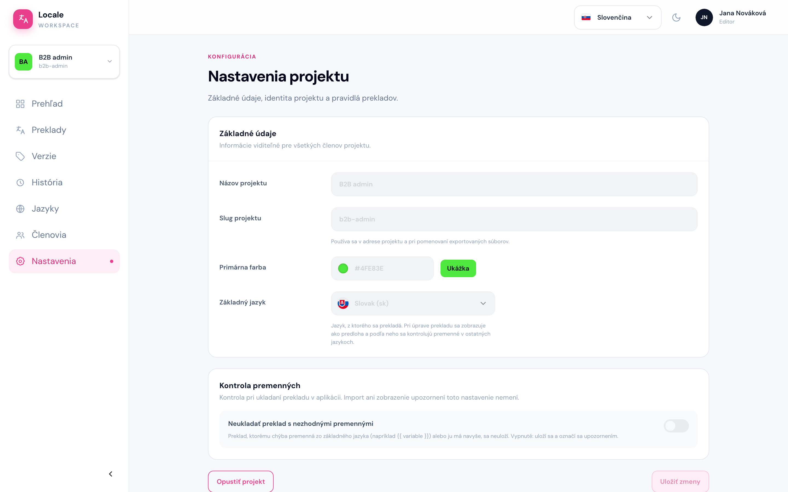

# Nastavenia

Cesta: `/projects/{projectSlug}/settings`

Stránka **Nastavenia projektu** ukazuje základné údaje projektu a pravidlá prekladov. Editor ich vidí iba na čítanie, mení ich vývojár.

- **Názov projektu** a **Slug projektu** – slug je časť adresy projektu (`/projects/b2b-admin/…`).
- **Primárna farba** – farba ikony projektu v zozname projektov.
- **Základný jazyk** – jazyk, z ktorého sa prekladá a podľa ktorého sa kontrolujú premenné.
- **Kontrola premenných** – keď je zapnutá, preklad s nesprávnymi premennými sa neuloží (pozri [Validácia pri uložení](./04-uprava-prekladu.md#validácia-pri-uložení)). Keď je vypnutá, preklad sa uloží a označí sa upozornením.

Jediné, čo tu editor môže urobiť, je **Opustiť projekt**. Projekt potom zmizne z vášho zoznamu projektov a späť vás môže pridať iba administrátor.
